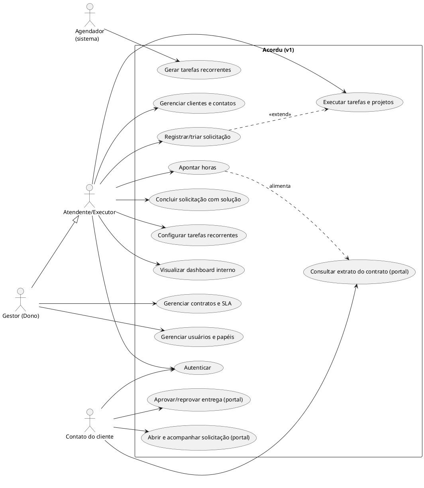
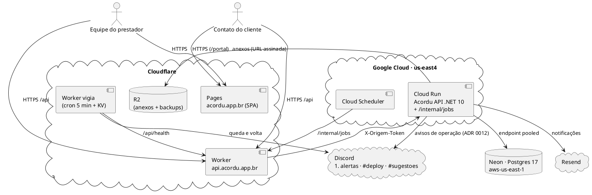
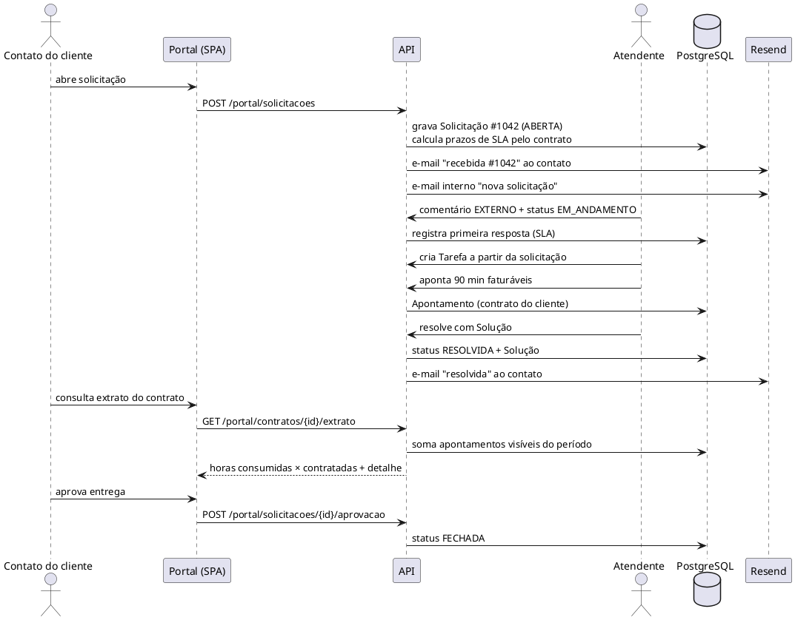

# Especificação de Requisitos de Software (ERS)
## Acordu — Gestão de Atendimento, Execução e Contratos para Prestadores de Serviço — v1

| | |
|---|---|
| **Versão** | 0.1 (rascunho para revisão) |
| **Data** | 13/11/2026 |
| **Produto** | Acordu |
| **Norma de referência** | ABNT NBR ISO/IEC/IEEE 29148:2018 (estrutura de SRS), forma condensada |
| **Documento de origem** | `estrategia-produto-acordu.md` (visão, público, posicionamento) |
| **Status** | Em elaboração |

---

## 1. Introdução

### 1.1 Propósito
Especificar os requisitos do release **v1** do Acordu: um sistema para pequenos prestadores de serviço registrarem as solicitações dos seus clientes, executarem o trabalho em tarefas e projetos, apontarem as horas gastas contra o contrato de cada cliente e **darem transparência ao cliente** por meio de um portal. O documento serve de base para a implementação e para a verificação do produto.

### 1.2 Escopo
Aplicação web (SPA) apoiada por uma API REST, **multi-tenant** desde o início (SaaS).

- **Faz no v1:** cadastro/autenticação e multiusuário (RBAC); clientes e contatos; contratos (mensal fixo, banco de horas, avulso) com SLA; solicitações com protocolo, status e SLA; tarefas, projetos e apontamento de horas; tarefas recorrentes; portal do cliente (status externo, SLA, extrato de horas, aprovação de entrega); registro de solução e sugestão de solicitações semelhantes já resolvidas; notificações por e-mail; dashboard interno.
- **Não faz no v1:** entrada de solicitação por e-mail e WhatsApp, base de conhecimento com artigos publicados, projeção do contrato, relatório mensal em PDF (todos **v2**); faturamento/cobrança, NFS-e, IA (rascunho de artigos, triagem, resumo) (**v3+**); app mobile nativo.

### 1.3 Visão geral do produto

**1.3.1 Perspectiva.** Sistema novo, escrito do zero, sem reaproveitar código, schema, telas ou documentação de nenhum sistema anterior (ver `estrategia-produto-acordu.md` §1). Arquitetura API-first; base técnica no ADR 0001.

**1.3.2 Funções.** Ver Seção 3.2 e o diagrama de casos de uso (Seção 2).

**1.3.3 Usuários.**

| Perfil | Quem é | Acessa |
|---|---|---|
| **Gestor** (papel Dono) | Sócio/gerente do prestador | Tudo, incluindo usuários, papéis, contratos e configuração. |
| **Atendente/Executor** (papel Membro) | Equipe do prestador | Solicitações, tarefas, projetos, apontamentos, clientes. |
| **Leitor** | Estagiário, sócio passivo | Somente leitura interna. |
| **Contato do cliente** (papel Cliente) | Pessoa da empresa atendida | Apenas o portal, restrito ao **seu** cliente. |
| **Operação da Nebrys** (F14) | Quem opera o Acordu na Nebrys | Apenas a área da Nebrys (RF-NEB-01): situação das empresas, convites e lista de espera; nunca os dados de negócio dos prestadores. |

**1.3.4 Limitações.** Planos gratuitos de serviços gerenciados (Cloud Run, Neon, Cloudflare; ADR 0010, com plano de escala). Cold start depois de ociosidade, atualização da agenda e do quadro por consulta a cada 30 s no nível 0 e alertas de SLA com até 15 min de atraso. Disponibilidade *best-effort* no v1.

### 1.4 Definições
Ver Apêndice B.

---

## 2. Casos de uso (visão geral)



---

## 3. Requisitos específicos

Convenções: **RF** = requisito funcional, **RNF** = não funcional. Verificação: **I** = Inspeção, **D** = Demonstração, **T** = Teste, **A** = Análise. Requisitos marcados **(v2)** estão aqui para rastreabilidade, fora do escopo do v1.

### 3.1 Interfaces externas
- **Usuário:** SPA responsiva; o **portal do cliente** é uma área da mesma SPA com layout e rotas próprias (`/portal`), otimizada para celular.
- **Software:** API REST autenticada (JSON); e-mail transacional (Resend); armazenamento de anexos em objeto (S3-compatível — Cloudflare R2).
- **Dados:** PostgreSQL 17 gerenciado (Neon), banco próprio do Acordu.
- **Localização:** pt-BR, fuso configurável por tenant (padrão `America/Sao_Paulo`), formatos brasileiros.

### 3.2 Requisitos funcionais

**Autenticação, tenant e multiusuário** — desenho do ADR 0001, transporte da sessão no ADR 0007
| ID | Requisito | Verif. |
|---|---|---|
| RF-AUT-01 | Cadastro por e-mail e senha, criando o Tenant (prestador) e o vínculo como Dono. | T |
| RF-AUT-02 | Login por e-mail/senha com access token (JWT) curto + refresh token revogável. | T |
| RF-AUT-03 | Toda requisição resolve o `TenantId` **ativo** do token e restringe o acesso aos dados desse tenant. | T |
| RF-AUT-04 | Confirmação de e-mail, política de senha e lockout. | T |
| RF-AUT-05 | Usuário com vínculos em vários tenants troca o tenant ativo, com reemissão do token. | T |
| RF-AUT-06 | **Envio a terceiros exige e-mail confirmado** (04/11): enquanto quem criou a empresa não confirmar o e-mail, a empresa não envia e-mail a ninguém além dele. Convites da equipe e do portal e link do portal são recusados com erro próprio; avisos automáticos por e-mail a contatos e à equipe não saem, exceto os do próprio criador (decisão 8 da spec do F9, 04/11); o sino interno não muda. O login e o uso do sistema continuam liberados (decisão de 09/10). Quem cria a empresa por convite da Nebrys (RF-AUT-08) já entra com o e-mail confirmado e a empresa liberada para enviar, porque o convite chegou por esse e-mail, como nos convites da equipe e do portal; por isso essa empresa não cai no expurgo do RF-AUT-07 (F14n, 23/11). | T |
| RF-AUT-07 | **Expurgo de cadastro abandonado** (04/11): empresa cujo criador não confirmou o e-mail em 7 dias e que não tem nenhum dado cadastrado além do que o registro cria é apagada, com o usuário, se ele não tiver vínculo com outra empresa. Roda no job diário. | T |
| RF-AUT-08 | **Cadastro controlado** (F14, 13/11): o cadastro funciona em um de dois modos, escolhido pela Nebrys. **Por convite:** só cria empresa quem tem um convite de empresa válido emitido pela Nebrys (uso único, com validade, revogável); sem convite, a tela de cadastro oferece a **lista de espera**, que a Nebrys transforma em convite. **Aberto:** como no RF-AUT-01. Nos dois valem o Turnstile e o limite por IP (RNF-SEG-10). O convite vale 7 dias e o cadastro usa o e-mail dele; a lista de espera pede nome, e-mail, nome da empresa e mensagem opcional, e a Nebrys escolhe quem convidar. O lançamento começa por convite; o modo aberto é o futuro (G2 do F14, 13/11). | T |
| RF-AUT-09 | **Um teste por CPF/CNPJ** (F14, 13/11): o cadastro pede o CPF ou o CNPJ da empresa (dígitos validados, CNPJ alfanumérico aceito); um documento que já teve teste, em qualquer empresa e mesmo depois do expurgo, não abre outro, salvo liberação da Nebrys. Exceção: a empresa apagada como cadastro abandonado (RF-AUT-07) libera o documento, porque o teste não foi usado. Depois do expurgo fica só um hash do documento, fora dos tenants (G2 do F14, 13/11). | T |
| RF-AUT-10 | **E-mail descartável bloqueado** (F14, 13/11): o cadastro e a lista de espera recusam e-mail de domínio descartável, por uma lista de domínios mantida no Acordu; o convite de empresa da área da Nebrys também não sai para ele (#224). | T |
| RF-AUT-11 | **Termos de uso e política de privacidade** (F14, 13/11): páginas públicas, com versão e data de vigência, com link no cadastro, no aceite de convite, no login, no portal e na lista de espera. O cadastro e o aceite de convite da equipe exigem o aceite, registrado por pessoa com a versão de cada texto e a data. Nova versão pede "ciente" no próximo acesso, sem bloquear o uso (G2 do F14, 13/11). Enquanto os textos não estão publicados (configuração do lançamento, a mesma no front e na API), as páginas e os links ficam escondidos, o cadastro e o aceite de convite não pedem aceite e nenhum aceite é registrado; publicados, quem não tem aceite recebe o "ciente" no próximo acesso, sem bloquear o uso (F14, 18/11). | T |
| RF-USR-01 | Convidar usuário interno por e-mail com um papel; aceitar cria conta ou adiciona vínculo. | T |
| RF-USR-02 | Remover usuário e alterar papel; garantir **≥ 1 Dono** por tenant. | T |
| RF-USR-03 | Autorizar cada ação por permissão (RBAC granular); sem permissão → 403. | T |
| RF-USR-04 | Semear os papéis padrão Dono, Membro, Leitor e **Cliente**. | D |

**Situação da empresa** (F14, 13/11)
| ID | Requisito | Verif. |
|---|---|---|
| RF-EMP-01 | Toda empresa tem uma **situação**: TESTE (nasce assim no cadastro, com data de fim do teste), ATIVA, VENCIDA ou CANCELADA. TESTE vira VENCIDA sozinha no job diário quando o fim do teste passa; ativar, prorrogar o teste, cancelar e reativar só pela Nebrys (RF-NEB-01), sem cobrança no v1. Sem limite de pessoas na equipe durante o teste (10/11). Teste de 30 dias corridos (G2 do F14, 13/11). | T |
| RF-EMP-02 | **Só leitura** em VENCIDA e CANCELADA: a equipe e o portal continuam lendo o que já podiam, mas nada da empresa é gravado (erro próprio, depois da checagem de permissão), nenhum e-mail sai (exceto os avisos da situação aos Donos, RF-EMP-04) e os jobs (recorrências, alertas, fechamento automático) não agem nela. O que é só da pessoa segue (conta, sino, preferências de aviso, link da agenda, seguir itens); aceitar convite da equipe ou do portal não. Voltar a ATIVA restaura tudo, sem gerar retroativamente. A situação de uma empresa nunca afeta outra, mesmo para quem tem vínculo nas duas. | T |
| RF-EMP-03 | **Expurgo da empresa vencida ou cancelada:** passado o prazo desde o vencimento ou o cancelamento, o job diário apaga a empresa inteira (dados, anexos, vínculos, sessões), com as contas que não tiverem vínculo com outra empresa, como no RF-AUT-07. Prazo de 30 dias (G2 do F14, 13/11). | T |
| RF-EMP-04 | **Avisos da situação:** a equipe vê na tela quanto falta para o fim do teste e, na empresa só leitura, desde quando e até quando os dados ficam; os Donos recebem e-mail antes do vencimento, no vencimento e antes do expurgo. Faixa nos últimos 7 dias do teste; e-mail 7 e 1 dia antes do fim do teste, no vencimento e 7 dias antes do expurgo (G2 do F14, 13/11). Canal da Nebrys nos avisos e nos textos: `contato@acordu.app.br`. | T |
| RF-EMP-05 | **Dados de exemplo:** uma empresa em teste ainda sem dados pode carregar um conjunto fictício (clientes, contratos, solicitações, tarefas, horas) e apagá-lo depois, sem e-mail a ninguém. | T |

**Área da Nebrys** (F14, 13/11)
| ID | Requisito | Verif. |
|---|---|---|
| RF-NEB-01 | Área restrita à operação da Nebrys, inalcançável por usuários de empresas e contatos (404): lista as empresas com a situação e as datas; ativa, prorroga o teste, cancela e reativa; emite, reenvia e revoga convites de empresa; trata a lista de espera; libera um CPF/CNPJ para novo teste. Mostra só dados da relação com a Nebrys (nome, documento, situação, datas, criador, tamanho da equipe), nunca dados de negócio dos prestadores (RNF-PRIV-01). Toda ação fica registrada com quem e quando. | T |
| RF-NEB-02 | **Empresa de demonstração**, criada e restaurada pela área da Nebrys com dados fictícios, para mostrar o produto: nunca vence nem é expurgada e não envia e-mail para fora. Entra quem a Nebrys indicar, com conta existente, como Dono (G2 do F14, 13/11). | T |

**Clientes e contatos**
| ID | Requisito | Verif. |
|---|---|---|
| RF-CLI-01 | Criar, editar, inativar e reativar clientes (reativação decidida em 16/10; o acesso ao portal não volta sozinho): nome (como a equipe chama o cliente), razão social, CPF/CNPJ (CNPJ numérico ou alfanumérico, IN RFB 2.229/2024; ampliado em 04/11), inscrição estadual (número ou ISENTO), e-mail e telefone gerais, endereço (CEP, logradouro, número, complemento, bairro, cidade, UF) e observações; só o nome é obrigatório. Ampliado em 16/10. | T |
| RF-CLI-02 | Criar, editar, inativar e reativar contatos de um cliente (nome, e-mail, telefone, cargo). | T |
| RF-CLI-03 | Conceder acesso ao portal a um contato (convite por e-mail), criando `Usuario` + `Vinculo` com papel Cliente e escopo no `ClienteId`. | T |
| RF-CLI-04 | Definir, por contato, se ele vê **só as próprias solicitações** ou **todas as do seu cliente**. | T |
| RF-CLI-05 | Revogar o acesso de um contato ao portal sem apagar seu histórico. | T |
| RF-CLI-06 | Definir o **responsável interno** do cliente (alguém da equipe), sugerido como responsável das solicitações novas dele, e filtrar a lista por responsável. Decidido em 16/10. | T |
| RF-CLI-07 | Marcar clientes com até 10 **etiquetas** livres (ex.: "condomínio", "varejo") e filtrar a lista por etiqueta, com as etiquetas em uso sugeridas. Decidido em 16/10. | T |
| RF-CLI-08 | **Preenchimento pelo CNPJ** (04/11): ao completar um CNPJ válido no cadastro do cliente, o formulário consulta uma API pública de dados abertos da Receita e preenche razão social, nome (nome fantasia, se houver), endereço e, se vazios, e-mail e telefone gerais, **sem sobrescrever o que já foi digitado**. Situação cadastral diferente de ativa gera aviso, sem bloquear. Falha ou indisponibilidade da consulta não impede o cadastro. Inscrição estadual continua manual. **CPF não é consultado** (dado pessoal, sem API pública; só a validação dos dígitos). | T |

**Contratos e SLA**
| ID | Requisito | Verif. |
|---|---|---|
| RF-CTR-01 | Criar contrato para um cliente, de um dos tipos: **MENSAL_FIXO** (com franquia de horas opcional), **BANCO_HORAS** (saldo de horas contratado) ou **AVULSO** (sem franquia). | T |
| RF-CTR-02 | Contrato tem vigência (início, fim opcional) e status (ATIVO, SUSPENSO, ENCERRADO); um cliente pode ter vários contratos, mas no máximo **um ATIVO de cada tipo** no mesmo período. | T |
| RF-CTR-03 | Contrato define **política de SLA**: prazo de primeira resposta e de resolução **por prioridade** (baixa, média, alta, urgente), em horas úteis. | T |
| RF-CTR-04 | Tenant define **horário comercial** e feriados; o relógio do SLA conta apenas horas úteis. | T |
| RF-CTR-05 | Consumo do contrato por **período de apuração mensal** (MENSAL_FIXO) ou **saldo corrente** (BANCO_HORAS), calculado a partir dos apontamentos faturáveis. | T |
| RF-CTR-06 | Registrar **ajuste de saldo** manual em banco de horas (recarga, estorno), com motivo e autor. | T |
| RF-CTR-07 | Alertar internamente quando o consumo atingir limiares configuráveis (padrão 80% e 100%). | T |

**Solicitações**
| ID | Requisito | Verif. |
|---|---|---|
| RF-SOL-01 | Registrar solicitação (título, descrição, cliente, contato solicitante, prioridade, categoria, contrato), pela equipe ou pelo portal. | T |
| RF-SOL-02 | Gerar **número de protocolo sequencial por tenant** (ex.: #1042), imutável. | T |
| RF-SOL-03 | Ciclo de status interno: ABERTA → EM_ANDAMENTO ↔ AGUARDANDO_CLIENTE / AGUARDANDO_TERCEIRO → RESOLVIDA → FECHADA; CANCELADA a partir de qualquer estado não final; transições inválidas são rejeitadas. A primeira resposta ao cliente, uma tarefa criada nela ou uma tarefa dela que passa a FAZENDO (inclusive pelo cronômetro) tiram a solicitação de ABERTA para EM_ANDAMENTO; resolver e cancelar podem concluir ou cancelar junto as tarefas abertas (F11). | T |
| RF-SOL-04 | Atribuir responsável (usuário interno) e categorias configuráveis pelo tenant. | T |
| RF-SOL-05 | Calcular o SLA: prazos de primeira resposta e resolução a partir da política do contrato; **pausar** o relógio em AGUARDANDO_CLIENTE; marcar em risco (≥ 75% do prazo) e violado. | T |
| RF-SOL-06 | Linha do tempo com comentários e anexos; cada item tem visibilidade **INTERNA** ou **EXTERNA**. Na tela, a resposta ao cliente (EXTERNA) vem marcada (F11, 06/11); na API, sem visibilidade, vale INTERNA. A resposta pode já pôr a solicitação em AGUARDANDO_CLIENTE ("Enviar e aguardar"). | T |
| RF-SOL-07 | Primeira resposta = primeiro comentário EXTERNO da equipe; registra o momento para o SLA. | T |
| RF-SOL-08 | Uma solicitação pode originar **uma ou mais tarefas**; seu tempo total é a soma dos apontamentos dessas tarefas. | T |
| RF-SOL-09 | Resolução automática para FECHADA após N dias em RESOLVIDA sem manifestação do cliente (padrão 5 dias). | T |
| RF-SOL-10 | Reabrir solicitação RESOLVIDA (equipe ou cliente) dentro do prazo do RF-SOL-09. | T |
| RF-SOL-11 **(v2)** | Criar solicitação a partir de e-mail recebido, com threading de respostas. | T |
| RF-SOL-12 **(v2)** | Criar solicitação a partir de WhatsApp (API oficial via provedor). | T |
| RF-SOL-13 | Solicitação FECHADA ou CANCELADA não recebe resposta ao cliente nem anexo, da equipe ou do portal; nota interna da equipe sem anexo continua (registro posterior). RESOLVIDA segue aberta à conversa enquanto pode ser reaberta. (F11, 06/11) | T |

**Tarefas e projetos**
| ID | Requisito | Verif. |
|---|---|---|
| RF-TAR-01 | Criar tarefa (título, descrição, responsável, prazo, estimativa em horas) avulsa, vinculada a uma solicitação e/ou a um projeto. Depois de criada, a tarefa pode entrar, trocar ou sair de projeto, desde que seja um projeto em andamento do mesmo cliente (F11d). | T |
| RF-TAR-02 | Status de tarefa: A_FAZER → FAZENDO → CONCLUIDA; CANCELADA. Visualização em lista e **quadro (kanban)**. | T |
| RF-TAR-03 | Checklist de subitens dentro da tarefa. | D |
| RF-TAR-04 | Marcar tarefa como **visível ao cliente** (aparece no portal quando vinculada a uma solicitação dele). | T |
| RF-PRJ-01 | Criar projeto para um cliente (nome, contrato, prazo, estimativa total de horas) e agrupar tarefas. O projeto pode nascer de uma solicitação, levando as tarefas abertas dela, e ser concluído ou cancelado junto com as tarefas abertas (F11e). | T |
| RF-PRJ-02 | Exibir progresso do projeto: tarefas concluídas/total e horas apontadas × estimadas. | T |

**Planejamento e agenda** — incluído em 14/10 (marco 13)
| ID | Requisito | Verif. |
|---|---|---|
| RF-PLN-01 | Capacidade semanal por pessoa da equipe (padrão 40h, de 0 a 168h), editável por quem gerencia papéis. | T |
| RF-PLN-02 | Planejar o dia em que a tarefa será feita, separado do prazo; projeto com início planejado opcional. | T |
| RF-PLN-03 | Agenda da equipe num período: solicitações pelo prazo de SLA, tarefas, projetos, próximas ocorrências de recorrências e marcos de contrato, com os dias úteis e feriados; cada tipo só para quem pode lê-lo. | T |
| RF-PLN-04 | Capacidade da semana: horas planejadas × capacidade por pessoa, com a contagem do que está sem estimativa. | T |

**Colaboração da equipe** — incluído em 14/10 (marcos 14 a 16)
| ID | Requisito | Verif. |
|---|---|---|
| RF-COL-01 | Comentários internos em tarefas, com anexos; imutáveis, excluídos só pelo autor; nunca aparecem no portal. | T |
| RF-COL-02 | Mencionar pessoas da equipe em interações internas e comentários de tarefa, com aviso no sino e por e-mail. | T |
| RF-COL-03 | Seguir solicitações e tarefas (automático para criador, responsável, quem comenta e quem é mencionado; manual para os demais) e receber avisos de novas interações, comentários e mudanças de status. | T |
| RF-COL-04 | Agenda assinável (ICS) por pessoa e atualização em tempo real da agenda e do quadro. | T |
| RF-COL-05 | Feed de atividade da equipe e aba de arquivos do cliente com todos os anexos. | T |

**Apontamento de horas**
| ID | Requisito | Verif. |
|---|---|---|
| RF-APT-01 | Registrar apontamento numa tarefa: data, **duração em minutos** (ou início/fim), descrição, faturável (sim/não). | T |
| RF-APT-02 | Cronômetro na tarefa (iniciar/parar) que gera o apontamento ao parar; no máximo **um cronômetro ativo por usuário**. Pode começar num horário de até 12 h atrás e ter a duração ajustada ao parar; pode ser iniciado ao criar a tarefa; lembrete opcional no expediente e aviso de cronômetro esquecido (F12). | T |
| RF-APT-03 | Apontamento faturável consome o **contrato da solicitação/projeto** da tarefa; sem contrato, é registrado como avulso. | T |
| RF-APT-04 | Apontamento tem visibilidade ao cliente (padrão: visível se faturável); a descrição externa pode diferir da interna. | T |
| RF-APT-05 | Editar/excluir apontamento apenas pelo autor ou por quem tem permissão; **período fechado** (mês já apurado e marcado como fechado pelo gestor) bloqueia edição. | T |

**Tarefas recorrentes**
| ID | Requisito | Verif. |
|---|---|---|
| RF-REC-01 | Configurar modelo de tarefa recorrente: título, descrição, cliente, contrato, responsável, checklist, estimativa. | T |
| RF-REC-02 | Regra de recorrência: SEMANAL (dia da semana), MENSAL (dia do mês), TRIMESTRAL, ANUAL; antecedência de geração em dias; fim opcional. | T |
| RF-REC-03 | Agendador gera a tarefa na data devida, **idempotente** (no máximo uma tarefa por recorrência e data de referência). | T |
| RF-REC-04 | Dia inexistente no mês (29–31) → **último dia do mês**. | T |
| RF-REC-05 | Pausar, retomar e encerrar a recorrência; pausar não gera tarefas retroativas ao retomar. | T |

**Portal do cliente**
| ID | Requisito | Verif. |
|---|---|---|
| RF-POR-01 | Contato do cliente abre solicitação pelo portal (formulário com título, descrição, prioridade sugerida, anexos). | T |
| RF-POR-02 | Lista e detalhe das solicitações com **status externo**: Recebida (ABERTA), Em andamento (EM_ANDAMENTO, AGUARDANDO_TERCEIRO), Aguardando você (AGUARDANDO_CLIENTE), Concluída (RESOLVIDA, FECHADA), Cancelada. | T |
| RF-POR-03 | Exibir responsável, prazo de SLA e situação (no prazo / em risco / vencido) de cada solicitação. | D |
| RF-POR-04 | Exibir apenas comentários, anexos, tarefas e apontamentos **EXTERNOS**; nunca itens internos. | T |
| RF-POR-05 | Contato responde (comentário) e anexa arquivos; responder em AGUARDANDO_CLIENTE retorna a solicitação a EM_ANDAMENTO. | T |
| RF-POR-06 | Aprovar entrega (RESOLVIDA → FECHADA) ou reprovar (volta a EM_ANDAMENTO, com motivo obrigatório). | T |
| RF-POR-07 | **Extrato do contrato**: horas contratadas × consumidas no período (ou saldo do banco de horas) e lista de apontamentos visíveis, por data e solicitação. | T |
| RF-POR-08 | **Link de acesso por solicitação** (sem senha, token de uso limitado e expiração) para contatos sem conta no portal, com acesso só àquela solicitação. | T |
| RF-POR-09 | Identidade visual do tenant no portal (nome e logotipo). | D |

**Conhecimento (solução reutilizável)**
| ID | Requisito | Verif. |
|---|---|---|
| RF-CON-01 | Ao resolver a solicitação, registrar a **solução** estruturada: problema, causa, solução (obrigatória a solução; demais opcionais). | T |
| RF-CON-02 | Ao abrir/visualizar uma solicitação, sugerir até 5 **solicitações semelhantes já resolvidas** do mesmo tenant, por busca textual (full-text em português + similaridade de trigramas). | T |
| RF-CON-03 **(v2)** | Artigos da base de conhecimento (interno/externo), "transformar solução em artigo" e publicação no portal. | T |
| RF-CON-04 **(v3)** | Rascunho de artigo gerado por IA a partir da solicitação, sem dados do cliente, publicado só após aprovação humana. | T |

**Notificações**
| ID | Requisito | Verif. |
|---|---|---|
| RF-NOT-01 | E-mail ao contato: solicitação recebida (com protocolo), comentário externo, aguardando você, resolvida. | T |
| RF-NOT-02 | E-mail interno: nova solicitação, atribuição, SLA em risco/violado, consumo de contrato ≥ limiar. | T |
| RF-NOT-03 | Notificações dentro do app (sino) para usuários internos. | D |
| RF-NOT-04 | Usuário configura quais notificações por e-mail recebe (exceto as obrigatórias de conta). | D |
| RF-NOT-05 | Notificação do sistema operacional pelo navegador, opcional por pessoa, com o app aberto (inclusive minimizado): avisos do sino, lembrete e cronômetro esquecido (F12). | D |

**Dashboard interno**
| ID | Requisito | Verif. |
|---|---|---|
| RF-DAS-01 | Fila: solicitações abertas por status, responsável e prioridade. | D |
| RF-DAS-02 | SLA: solicitações em risco e violadas; taxa de cumprimento no período. | D |
| RF-DAS-03 | Horas: apontadas por cliente, contrato e usuário no período; faturável × não faturável. | D |
| RF-DAS-04 | Contratos: consumo de cada contrato ativo no período corrente. | D |
| RF-DAS-05 | Próximas tarefas recorrentes e tarefas vencidas. | D |

**Sugestões** (F13, 10/11)
| ID | Requisito | Verif. |
|---|---|---|
| RF-SUG-01 | "Sugerir melhoria" para qualquer pessoa da equipe (nunca pelo portal): texto de 10 a 2.000 caracteres, até 5 por hora por pessoa. Guardada fora dos tenants (a empresa e a pessoa só como referência) e avisada à Nebrys em #sugestoes com o texto, a tela e o nome da empresa, sem o nome nem o e-mail da pessoa. | T |

### 3.3 Requisitos não funcionais

**Segurança e isolamento**
| ID | Requisito | Verif. |
|---|---|---|
| RNF-SEG-01 | Isolamento multi-tenant por `TenantId` via *global query filter*; recurso de outro tenant → 404. | T |
| RNF-SEG-02 | **Isolamento por cliente dentro do tenant:** usuário com papel Cliente só enxerga dados do seu `ClienteId` (e, se configurado, só as próprias solicitações). Imposto na Application e na consulta, nunca só na UI. Teste obrigatório: contato do cliente A nunca vê dados do cliente B do mesmo tenant. | T |
| RNF-SEG-03 | Itens INTERNOS nunca são serializados em respostas destinadas ao portal (DTOs de portal separados dos internos). | T |
| RNF-SEG-04 | Senhas com hash forte (Identity/PBKDF2 ou Argon2). | I |
| RNF-SEG-05 | RBAC imposto no backend por caso de uso; sem permissão → 403. | T |
| RNF-SEG-06 | Link de acesso do portal: token aleatório ≥ 128 bits, armazenado como hash, expiração (padrão 30 dias), revogável, escopo de uma solicitação. | T |
| RNF-SEG-07 | Anexos: tamanho máximo (padrão 20 MB), lista de tipos permitidos, download só via URL assinada de curta duração após checagem de permissão. | T |
| RNF-SEG-08 | Rate limiting no login, no portal e no envio de formulários públicos. | T |
| RNF-SEG-09 | Headers de segurança e HTTPS obrigatório (Cloudflare na borda; ADR 0010). | I |
| RNF-SEG-10 | **Proteção do cadastro contra automação** (04/11): desafio Cloudflare Turnstile no cadastro, validado no servidor (sem SDK, por HTTP; desligado em dev e testes por configuração), e limite próprio de cadastros por IP (padrão 3 por hora), separado do limite das demais rotas de `/auth`. | T |

**Auditoria**
| ID | Requisito | Verif. |
|---|---|---|
| RNF-AUD-01 | Registrar ações sensíveis: login (sucesso/falha); convite/remoção/troca de papel; concessão/revogação de acesso ao portal; criação/edição de contrato; ajuste de saldo; edição/exclusão de apontamento; mudança de status de solicitação. | T |
| RNF-AUD-02 | Toda entidade de negócio registra criado/alterado em (UTC) e por quem. | I |

**Privacidade / LGPD**
| ID | Requisito | Verif. |
|---|---|---|
| RNF-PRIV-01 | O prestador é o **controlador** dos dados de seus clientes; o Acordu é **operador**. Exportação e exclusão dos dados do tenant sob solicitação. | A |
| RNF-PRIV-02 | Dados de um tenant nunca são usados em funcionalidades de outro tenant (incluindo sugestões e, futuramente, IA). | A |
| RNF-PRIV-03 | A política de privacidade (RF-AUT-11) informa os papéis de controlador e operador, a hospedagem nos EUA e a transferência internacional de dados (LGPD), a retenção (expurgos e backups) e o canal do titular; o texto é revisado pelo Daniel antes de valer (F14, 13/11). | I |

**Desempenho** (envelope compartilhado de 2 OCPU / 12 GB)
| ID | Requisito | Verif. |
|---|---|---|
| RNF-DES-01 | Listagens e dashboard com até ~50.000 solicitações e ~200.000 apontamentos por tenant: p95 < 800 ms. | T |
| RNF-DES-02 | Sugestão de semelhantes (RF-CON-02): p95 < 500 ms. | T |
| RNF-DES-03 | Agendador de recorrências processa todos os tenants em < 1 min por execução no volume acima. | T |

**Portabilidade, disponibilidade e localização**
| ID | Requisito | Verif. |
|---|---|---|
| RNF-POR-01 | Stack vendor-neutra (API em container OCI padrão + PostgreSQL 17 + armazenamento S3-compatível); nenhum SDK de provedor no código, configuração só por variável de ambiente; migrations aditivas. | I |
| RNF-DIS-01 | Backup diário do banco para armazenamento de objetos fora do provedor do banco; restore testado. Anexos com cópia fora do provedor de arquivos a partir do primeiro cliente pagante (ADR 0010 §8; decidido em 03/11/2026). | D |
| RNF-LOC-01 | Datas persistidas em UTC; exibição e cálculo de SLA no fuso do tenant. | T |
| RNF-UX-01 | App instalável (PWA) para a equipe, com ícone próprio; o service worker não guarda respostas da API (F12). | D |

**Operação** (F13, 10/11; ADR 0012)
| ID | Requisito | Verif. |
|---|---|---|
| RNF-OPS-01 | Logs estruturados (JSON, um por linha, formato que o Error Reporting agrupa, sem SDK): erro com rota modelo, método e identificadores de tenant e usuário; nunca corpo, query string, cabeçalhos, e-mail ou nome. | T |
| RNF-OPS-02 | A operação é avisada no Discord, pela própria aplicação e sem SDK, de erro novo, falha de job, queda da API, deploy e backup, com deduplicação (uma vez a cada 24 h por erro, teto de 20 avisos por hora) e menções desligadas; a falha do aviso nunca muda a resposta ao usuário. | T |
| RNF-OPS-03 | Os erros do app no navegador são registrados por rota própria, pública, com limite por IP e corpo pequeno, sem dado pessoal nem identificador de contato ou cliente. | T |

### 3.4 Requisitos de banco de dados (modelo lógico)

Identidade e acesso (`Usuario`, `Tenant`, `Vinculo`, `Papel`, `Permissao`, `LogAuditoria`) seguem o desenho do ADR 0001; `Vinculo` ganha `clienteId` (opcional, obrigatório para o papel Cliente) e `escopoPortal`.

```plantuml
@startuml
hide circle
skinparam classAttributeIconSize 0

class Vinculo {
  +id: Guid
  +usuarioId: Guid
  +tenantId: Guid
  +papelId: Guid
  +clienteId: Guid?
  +escopoPortal: EscopoPortal?
}
class Cliente {
  +id: Guid
  +tenantId: Guid
  +nome: string
  +documento: string?
  +ativo: bool
}
class Contato {
  +id: Guid
  +tenantId: Guid
  +clienteId: Guid
  +nome: string
  +email: string
  +telefone: string?
  +usuarioId: Guid?
  +ativo: bool
}
class Contrato {
  +id: Guid
  +tenantId: Guid
  +clienteId: Guid
  +tipo: TipoContrato
  +inicio: Date
  +fim: Date?
  +franquiaMinutos: int?
  +status: StatusContrato
}
class PoliticaSla {
  +contratoId: Guid
  +prioridade: Prioridade
  +primeiraRespostaMin: int
  +resolucaoMin: int
}
class AjusteSaldo {
  +id: Guid
  +tenantId: Guid
  +contratoId: Guid
  +minutos: int
  +motivo: string
}
class Solicitacao {
  +id: Guid
  +tenantId: Guid
  +numero: int
  +clienteId: Guid
  +contatoId: Guid?
  +contratoId: Guid?
  +titulo: string
  +descricao: string
  +prioridade: Prioridade
  +status: StatusSolicitacao
  +responsavelId: Guid?
  +categoriaId: Guid?
  +origem: OrigemSolicitacao
  +primeiraRespostaEm: DateTime?
  +prazoPrimeiraResposta: DateTime?
  +prazoResolucao: DateTime?
  +resolvidaEm: DateTime?
}
class Solucao {
  +solicitacaoId: Guid
  +problema: string?
  +causa: string?
  +solucao: string
}
class Interacao {
  +id: Guid
  +tenantId: Guid
  +solicitacaoId: Guid
  +autorId: Guid
  +texto: string
  +visibilidade: Visibilidade
}
class Anexo {
  +id: Guid
  +tenantId: Guid
  +interacaoId: Guid
  +nomeArquivo: string
  +tamanhoBytes: long
  +chaveArmazenamento: string
}
class Projeto {
  +id: Guid
  +tenantId: Guid
  +clienteId: Guid
  +contratoId: Guid?
  +nome: string
  +prazo: Date?
  +estimativaMin: int?
}
class Tarefa {
  +id: Guid
  +tenantId: Guid
  +titulo: string
  +status: StatusTarefa
  +responsavelId: Guid?
  +prazo: Date?
  +estimativaMin: int?
  +solicitacaoId: Guid?
  +projetoId: Guid?
  +recorrenciaId: Guid?
  +dataReferencia: Date?
  +visivelCliente: bool
}
class Apontamento {
  +id: Guid
  +tenantId: Guid
  +tarefaId: Guid
  +usuarioId: Guid
  +contratoId: Guid?
  +data: Date
  +minutos: int
  +descricao: string
  +descricaoExterna: string?
  +faturavel: bool
  +visivelCliente: bool
}
class RecorrenciaTarefa {
  +id: Guid
  +tenantId: Guid
  +clienteId: Guid
  +contratoId: Guid?
  +modelo: ModeloTarefa
  +periodicidade: Periodicidade
  +diaReferencia: int
  +antecedenciaDias: int
  +proximaData: Date
  +status: StatusRecorrencia
}
class AcessoPortal {
  +id: Guid
  +tenantId: Guid
  +solicitacaoId: Guid
  +contatoId: Guid
  +tokenHash: string
  +expiraEm: DateTime
  +revogado: bool
}
class ConvitePortal {
  +id: Guid
  +tenantId: Guid
  +clienteId: Guid
  +contatoId: Guid
  +escopo: EscopoPortal
  +criadoEm: DateTime
  +tokenHash: string?
  +expiraEm: DateTime?
  +aceitoEm: DateTime?
  +usuarioId: Guid?
  +revogadoEm: DateTime?
}
class ConviteEquipe {
  +id: Guid
  +tenantId: Guid
  +email: string
  +papelId: Guid
  +convidadoPor: Guid
  +criadoEm: DateTime
  +tokenHash: string?
  +expiraEm: DateTime?
  +aceitoEm: DateTime?
  +usuarioId: Guid?
  +revogadoEm: DateTime?
}

Cliente "1" --> "*" Contato
Cliente "1" --> "*" Contrato
Contrato "1" --> "*" PoliticaSla
Contrato "1" --> "*" AjusteSaldo
Cliente "1" --> "*" Solicitacao
Contrato "0..1" --> "*" Solicitacao
Solicitacao "1" --> "0..1" Solucao
Solicitacao "1" --> "*" Interacao
Interacao "1" --> "*" Anexo
Solicitacao "0..1" --> "*" Tarefa
Projeto "0..1" --> "*" Tarefa
RecorrenciaTarefa "0..1" --> "*" Tarefa
Tarefa "1" --> "*" Apontamento
Contrato "0..1" --> "*" Apontamento
Solicitacao "1" --> "*" AcessoPortal
Contato "1" --> "*" ConvitePortal
ConvitePortal "0..1" --> "0..1" Vinculo : aceite cria
ConviteEquipe "0..1" --> "0..1" Vinculo : aceite cria

enum TipoContrato { MENSAL_FIXO\nBANCO_HORAS\nAVULSO }
enum StatusContrato { ATIVO\nSUSPENSO\nENCERRADO }
enum Prioridade { BAIXA\nMEDIA\nALTA\nURGENTE }
enum StatusSolicitacao { ABERTA\nEM_ANDAMENTO\nAGUARDANDO_CLIENTE\nAGUARDANDO_TERCEIRO\nRESOLVIDA\nFECHADA\nCANCELADA }
enum OrigemSolicitacao { INTERNA\nPORTAL\nEMAIL\nWHATSAPP }
enum Visibilidade { INTERNA\nEXTERNA }
enum StatusTarefa { A_FAZER\nFAZENDO\nCONCLUIDA\nCANCELADA }
enum Periodicidade { SEMANAL\nMENSAL\nTRIMESTRAL\nANUAL }
enum StatusRecorrencia { ATIVA\nPAUSADA\nENCERRADA }
enum EscopoPortal { PROPRIAS\nTODAS_DO_CLIENTE }
@enduml
```

Observações de modelagem:
- Toda entidade de negócio carrega `TenantId` (indexado). Entidades ligadas a um cliente carregam `ClienteId` para permitir o filtro do RNF-SEG-02 sem joins.
- **Tempo em minutos inteiros** (`int`), nunca `float` (ADR 0004). Conversão para horas só na apresentação.
- `(TenantId, Numero)` único em `Solicitacao`; `(RecorrenciaId, DataReferencia)` único em `Tarefa` (idempotência do RF-REC-03).
- O **consumo do contrato não é estado persistido**: é read model (soma de apontamentos faturáveis + ajustes no período).
- `OrigemSolicitacao` já prevê EMAIL e WHATSAPP (v2) para não exigir migration de enum depois.
- **Convites** (RF-USR-01 e RF-CLI-03): `ConviteEquipe` convida um e-mail para um papel **interno**; `ConvitePortal` convida um **contato** para o portal, com o escopo do vínculo (é raiz com `ClienteId`, sob o filtro do ADR 0002). Os dois guardam só o **hash** do token, valem 7 dias a partir do envio, são de uso único e ficam pendentes até serem aceitos ou revogados (`aceitoEm`/`revogadoEm`). Reenviar gera token novo e invalida o anterior. O aceite cria o `Vinculo` (e o `Usuario`, se a conta não existe) e registra o `usuarioId`. Papel Cliente nunca entra por `ConviteEquipe`, nem papel interno por `ConvitePortal`.
- **Refresh tokens** ficam na tabela de identidade (hash, usuário, tenant, validade, consumo e revogação), fora do domínio; o transporte da sessão está no ADR 0007.
- Valores monetários de contrato (mensalidade, valor-hora) ficam **fora do v1** — entram com o faturamento (v3), usando o value object `Dinheiro`.

### 3.5 Restrições de projeto
- Runtime **.NET 10**; **EF Core + Npgsql**; **PostgreSQL 17** (extensões `pg_trgm` e `unaccent` para RF-CON-02).
- Frontend **React + Vite (TS)**; tipos gerados do OpenAPI.
- API em container no **Cloud Run**, SPA no **Cloudflare Pages** (`acordu.app.br`), API em `api.acordu.app.br` por um Worker; nenhum SDK de provedor no código (ADR 0010).
- Agendador (recorrências, fechamento automático, alertas de SLA) roda como **endpoints internos idempotentes** (`/internal/jobs/*`, com token), disparados pelo Cloud Scheduler (ADR 0010).
- CI/CD: GitHub Actions (imagem amd64) → Artifact Registry → Cloud Run, por Workload Identity Federation.
- Convenções de código, commit e estrutura em `docs/`, prefixo `Acordu.*`.

### 3.6 Atributos de qualidade
Prioridade decrescente no v1: **isolamento (tenant e cliente)**, **corretude do tempo e do SLA** (horas apontadas e prazos são a base da cobrança e da confiança), **simplicidade de uso** (implantação em uma tarde), **privacidade (LGPD)**, **desempenho** dentro dos planos gratuitos.

---

## 4. Arquitetura de implantação (referência)



---

## 5. Fluxo-chave: solicitação → execução → horas → extrato (sequência)



---

## 6. Estratégia de testes

Pirâmide de testes (xUnit + AwesomeAssertions, Testcontainers, WebApplicationFactory; Vitest no front; Playwright nos fluxos principais).

### 6.1 Núcleo de maior risco (unitários de domínio)
- **Máquina de estados** de `Solicitacao`, `Tarefa`, `Contrato`, `RecorrenciaTarefa` (transições válidas e inválidas).
- **Cálculo de SLA em horas úteis**: horário comercial, fins de semana, feriados, fuso, pausa em AGUARDANDO_CLIENTE, virada de dia/mês.
- **Consumo de contrato**: franquia mensal, banco de horas com ajustes, apontamentos não faturáveis, período fechado.
- **Geração de recorrências**: datas, fim de mês, antecedência, idempotência, pausa/retomada.

### 6.2 Testes críticos de isolamento
- **RNF-SEG-01:** acesso cross-tenant → vazio/404 (integração e API).
- **RNF-SEG-02:** contato do cliente A não lê, lista, comenta nem baixa anexo do cliente B do mesmo tenant; contato com escopo PROPRIAS não vê solicitações de colegas.
- **RNF-SEG-03:** nenhuma resposta do portal contém interação, tarefa ou apontamento INTERNO.
- **RNF-SEG-06:** link de acesso expirado, revogado ou de outra solicitação → negado.
- **RF-EMP-02:** empresa vencida ou cancelada não grava nem envia nada, na equipe, no portal e nos jobs; a mesma pessoa grava normalmente em outra empresa onde tem vínculo.
- **RF-NEB-01:** usuário de empresa (inclusive Dono) e contato do portal nunca alcançam a área da Nebrys (404); a área não expõe dado de negócio dos prestadores.
- **RF-AUT-06:** empresa com criador sem e-mail confirmado não consegue convidar, emitir link do portal nem disparar aviso a terceiros; depois da confirmação, consegue.

### 6.3 Rastreabilidade
Cada requisito com verificação **T** tem ao menos um teste automatizado associado.

---

## Apêndice A — Premissas e dependências
- **Verticais de entrada ainda não escolhidas.** Cenários de referência desta versão: **agência** (projetos + solicitações de ajuste, contrato mensal) e **escritório de contabilidade** (tarefas recorrentes mensais + dúvidas de clientes). Revisar os requisitos quando a validação escolher as verticais.
- Planos gratuitos do Cloud Run, Neon e Cloudflare vigentes; ao se aproximar dos limites, subir de nível (ADR 0010).
- Resend como provedor de e-mail (substituível); anexos no Cloudflare R2 via API S3-compatível.
- Nada do ASMTasks é reaproveitado (ver `estrategia-produto-acordu.md` §1).

## Apêndice B — Definições
- **Tenant / prestador:** empresa que assina o Acordu; unidade de isolamento.
- **Cliente:** organização atendida pelo prestador.
- **Contato:** pessoa do cliente; pode ter acesso ao portal.
- **Solicitação:** pedido do cliente, com protocolo, status e SLA.
- **Tarefa:** unidade de execução; pode vir de solicitação, projeto ou recorrência.
- **Apontamento:** registro do tempo gasto numa tarefa.
- **Contrato:** acordo com o cliente que define franquia/saldo de horas e SLA.
- **SLA:** prazos de primeira resposta e de resolução, medidos em horas úteis.
- **Status externo:** tradução do status interno exibida ao cliente no portal.
- **Horas úteis:** tempo dentro do horário comercial do tenant, excluindo feriados.
