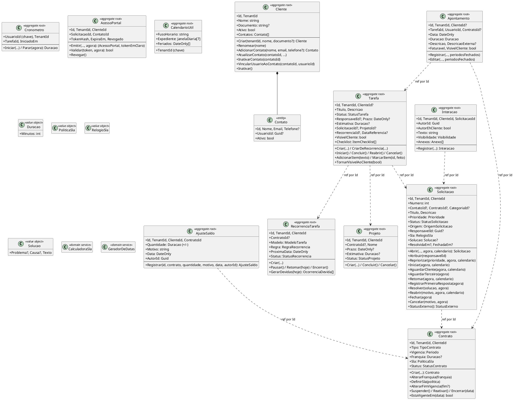

# Acordu — Modelo de Domínio Detalhado (v1)

| | |
|---|---|
| **Versão** | 0.2 |
| **Data** | 02/10/2026 |
| **Bounded context** | Atendimento e Execução de Serviços (único no v1) |
| **Base** | `ERS-acordu-v1.md` |
| **Natureza** | Especificação de modelo. Operações são contratos (assinaturas), **sem implementação** — guia para a codificação. |

---

## 1. Princípios de modelagem

Mesmos do Saldu:

- **Agregados pequenos.** Coleções que crescem sem limite (interações, apontamentos, ajustes) viram agregados próprios.
- **Referência por Id entre agregados.** Nunca navegação de objeto entre raízes.
- **Encapsulamento.** Sem setters públicos; estado muda por métodos que protegem invariantes; criação por *factory method*.
- **Value objects imutáveis**, comparados por valor.
- **`TenantId` em toda raiz**, definido na criação e imutável. Raízes ligadas a um cliente carregam também **`ClienteId`** (ADR 0002 — escopo do portal).
- **Tempo é `Duracao` em minutos inteiros**, nunca `double` (ADR 0004). É o `Dinheiro` do Acordu.
- **Instantes em UTC** (`DateTimeOffset`); datas civis (`DateOnly`) só onde o conceito é um dia (prazo de tarefa, data do apontamento, data de referência de recorrência).
- **O domínio não lê relógio.** Todo método que depende do "agora" recebe o instante como parâmetro (`agora: DateTimeOffset`). Isso torna o núcleo determinístico e testável.

---

## 2. Diagrama de classes

---

## 3. Decisões-chave de fronteira

### 3.1 `Interacao` fora de `Solicitacao`
Uma solicitação pode ter dezenas de comentários e anexos; mudar o status não deve carregar todos. `Interacao` é agregado próprio referenciando `SolicitacaoId`.

**Consequência:** a regra "primeira resposta = primeiro comentário EXTERNO da equipe" cruza agregados. É orquestrada na Application: ao registrar uma interação externa de autor interno, o handler chama `solicitacao.RegistrarPrimeiraResposta(agora)`, que é idempotente (só grava na primeira vez). O mesmo handler move AGUARDANDO_CLIENTE → EM_ANDAMENTO quando o **cliente** responde (RF-POR-05).

### 3.2 `Apontamento` e `AjusteSaldo` fora de `Contrato`
Crescem sem limite. **Consumo do contrato não é estado**: é read model (soma de apontamentos faturáveis + ajustes no período) — ver `read-side-acordu-v1.md` (a escrever). Não existe `Contrato.Consumo()`.

### 3.3 `Contato` dentro de `Cliente`
Coleção pequena e com invariante local (e-mail único entre os contatos ativos do cliente). Referenciado de fora por `ContatoId`.

### 3.4 `Cronometro` como agregado por usuário
A invariante "no máximo um cronômetro ativo por usuário" (RF-APT-02) vira chave: um registro por `(TenantId, UsuarioId)`. Parar o cronômetro devolve a `Duracao` e a Application cria o `Apontamento`.

### 3.5 Número de protocolo
Sequencial por tenant, gerado na Infrastructure (tabela de contadores com `UPDATE ... RETURNING` na mesma transação). O domínio recebe o número pronto em `Abrir`; invariante: `Numero > 0` e imutável.

---

## 4. Agregados em detalhe

### 4.1 Cliente
- **Invariantes:** nome obrigatório; e-mail de contato válido e único entre contatos ativos do cliente; contato inativo não pode ser vinculado a usuário.
- `VincularUsuarioAoContato` é chamado quando o contato aceita o convite do portal (RF-CLI-03).
- Inativar cliente não apaga histórico; a Application bloqueia novas solicitações para cliente inativo.

### 4.2 Contrato
- **Invariantes:**
  - `MENSAL_FIXO`: franquia opcional (> 0 se informada).
  - `BANCO_HORAS`: franquia **obrigatória** (saldo inicial contratado).
  - `AVULSO`: sem franquia.
  - `Vigencia.Fim ≥ Vigencia.Inicio`.
  - `PoliticaSla` completa: um prazo de primeira resposta e um de resolução para cada `Prioridade`; resolução ≥ primeira resposta.
- **Transições:** ATIVO ↔ SUSPENSO; ATIVO/SUSPENSO → ENCERRADO (final).
- **Regra entre contratos** (RF-CTR-02 — no máximo um ATIVO de cada tipo por cliente no mesmo período): envolve vários agregados → verificada na Application antes de criar/reativar, com índice parcial de apoio no banco.

| Operação | Invariante protegida |
|---|---|
| `Criar` | tipo × franquia coerentes; vigência válida; SLA completo |
| `AlterarFranquia` | coerência com o tipo; contrato não ENCERRADO |
| `DefinirSla` | política completa; contrato não ENCERRADO |
| `AlterarFimVigencia` | fim ≥ início; contrato não ENCERRADO (alimenta o `PATCH` de vigência) |
| `Suspender`/`Reativar`/`Encerrar` | transições válidas; `Encerrar(data)` fecha a vigência em `data` sem nunca estendê-la |

- Operação em contrato ENCERRADO lança `TransicaoInvalidaException`; franquia incoerente com o tipo lança `ContratoIncoerenteException`.
- `EstaVigenteEm(data)` = ATIVO **e** `Vigencia.Contem(data)` (SUSPENSO não está vigente).

### 4.2.1 AjusteSaldo
- `Registrar` recebe o `Contrato` (só leitura): herda `TenantId`/`ClienteId` dele e valida localmente que é **BANCO_HORAS**, não ENCERRADO e que `data ≥ Vigencia.Inicio` (`ContratoIncoerenteException`).
- Quantidade ≠ 0 (`DuracaoAssinada`), motivo obrigatório (≤ 1.000) e `AutorId` obrigatório (RF-CTR-06: "com motivo e autor").

### 4.3 Solicitacao
- **Invariantes:** título obrigatório; cliente obrigatório; se houver contrato, deve ser do mesmo cliente (checado na Application, que carrega o contrato); `Solucao.Texto` obrigatório para resolver; motivo obrigatório para cancelar e para reabrir quando vindo do cliente (reprovação).

**Máquina de estados (RF-SOL-03):**

| De \ Para | EM_ANDAMENTO | AGUARDANDO_CLIENTE | AGUARDANDO_TERCEIRO | RESOLVIDA | FECHADA | CANCELADA |
|---|---|---|---|---|---|---|
| ABERTA | `Iniciar` | `AguardarCliente` | `AguardarTerceiro` | `Resolver` | — | `Cancelar` |
| EM_ANDAMENTO | — | `AguardarCliente` | `AguardarTerceiro` | `Resolver` | — | `Cancelar` |
| AGUARDANDO_CLIENTE | `Retomar` | — | — | `Resolver` | — | `Cancelar` |
| AGUARDANDO_TERCEIRO | `Retomar` | — | — | `Resolver` | — | `Cancelar` |
| RESOLVIDA | `Reabrir` | — | — | — | `Fechar` | — |
| FECHADA / CANCELADA | finais | | | | | |

Qualquer transição fora da tabela lança `TransicaoInvalidaException`.

**Status externo (RF-POR-02)** — função pura do status interno:

| Interno | Externo |
|---|---|
| ABERTA | RECEBIDA |
| EM_ANDAMENTO, AGUARDANDO_TERCEIRO | EM_ANDAMENTO |
| AGUARDANDO_CLIENTE | AGUARDANDO_VOCE |
| RESOLVIDA, FECHADA | CONCLUIDA |
| CANCELADA | CANCELADA |

`AGUARDANDO_TERCEIRO` aparece ao cliente como "Em andamento" de propósito: o problema do fornecedor é do prestador, não do cliente — e o relógio do SLA **não** pausa nesse estado.

- **Emite:** `SolicitacaoAberta`, `SolicitacaoStatusAlterado`, `SolicitacaoResolvida`, `SolicitacaoReaberta`, `PrimeiraRespostaRegistrada`.

### 4.4 RelogioSla (value object dentro de Solicitacao) — ver ADR 0003
Campos: `PrazoPrimeiraResposta`, `PrazoResolucao`, `LimiteRisco` (instante em que 75% do tempo útil é atingido — permite filtrar "em risco" no SQL, ver read side §5), `PrimeiraRespostaEm?`, `PausadoDesde?`, `MinutosUteisRestantesResolucao?`. Todos os instantes são recalculados juntos em abrir, pausar, retomar, repriorizar e reabrir.

Regras:
1. **Abrir:** prazos = `CalculadoraSla.Somar(calendario, agora, minutosDaPolitica)`. Sem contrato → sem prazos (SLA não se aplica).
2. **Pausar** (entrar em AGUARDANDO_CLIENTE): guarda `MinutosUteisRestantesResolucao = CalculadoraSla.MinutosUteisEntre(calendario, agora, PrazoResolucao)` e `PausadoDesde = agora`. O prazo de primeira resposta **não** pausa (se ainda não houve resposta, pedir informação ao cliente já é a primeira resposta).
3. **Retomar:** `PrazoResolucao = Somar(calendario, agora, MinutosUteisRestantesResolucao)`; limpa a pausa.
4. **Repriorizar:** recalcula os prazos a partir do **instante de abertura** com a nova política, descontando o tempo pausado acumulado.
5. **Situação** em um instante: `NO_PRAZO`, `EM_RISCO` (≥ 75% do tempo útil consumido) ou `VIOLADO`; pausado → situação congelada.
6. **Reabrir:** novo ciclo de resolução com o prazo cheio da prioridade, a partir do instante da reabertura (decisão simples e explicável; revisar com uso real).

### 4.5 Interacao
- **Invariantes:** texto ou ao menos um anexo; autor cliente ⇒ visibilidade EXTERNA obrigatória; anexo com tamanho ≤ limite e tipo permitido (limites vêm da configuração, passados como parâmetro).
- Anexo guarda metadados + `ChaveArmazenamento`; o binário vive no object storage (ADR 0005 do Saldu — complementares).
- **Emite:** `InteracaoRegistrada` (com `Visibilidade` e `AutorEhCliente`) — gatilho das regras do §3.1 e das notificações.

### 4.6 Tarefa
- **Transições:** A_FAZER → FAZENDO → CONCLUIDA; A_FAZER/FAZENDO → CANCELADA; CONCLUIDA → FAZENDO (`Reabrir`).
- **Invariantes:** título obrigatório; `VisivelCliente` só pode ser verdadeiro se houver `SolicitacaoId` ou `ProjetoId` com cliente; `(RecorrenciaId, DataReferencia)` preenchidos juntos ou nenhum.
- `ClienteId` é herdado da solicitação/projeto/recorrência na criação (desnormalizado para o filtro do portal).
- Checklist: itens com texto não vazio, limite razoável (ex.: 50).
- **Emite:** `TarefaConcluida`.

### 4.7 Projeto
- Transições: EM_ANDAMENTO → CONCLUIDO / CANCELADO. Progresso (tarefas concluídas, horas × estimativa) é read model.

### 4.8 Apontamento
- **Invariantes:**
  - `Duracao > 0` e ≤ 24h.
  - `Data` não pode estar num **período fechado** do contrato (RF-APT-05). A lista de períodos fechados é passada pela Application.
  - `DescricaoExterna` só faz sentido se `VisivelCliente`.
  - `ContratoId` é resolvido na Application a partir da solicitação/projeto da tarefa e **congelado** no registro: mudar o contrato da solicitação depois não reescreve horas já apontadas.
  - Padrão (RF-APT-04): `VisivelCliente = Faturavel`, ajustável.
- Autorização (autor ou permissão `apontamento.editar_todos`) é da Application.
- **Emite:** `ApontamentoRegistrado`, `ApontamentoAlterado`, `ApontamentoExcluido` → recalcular consumo e checar limiares (RF-CTR-07).

### 4.9 RecorrenciaTarefa
- `ModeloTarefa` (VO): título, descrição, responsável, checklist, estimativa, visível ao cliente.
- `RegraRecorrencia` (VO): periodicidade (SEMANAL/MENSAL/TRIMESTRAL/ANUAL), dia de referência (dia da semana ou do mês), antecedência em dias (≥ 0), fim opcional.
- `GerarDevidas(hoje)`: devolve as ocorrências cuja `dataReferencia − antecedência ≤ hoje`, a partir de `ProximaData`, e avança `ProximaData`. Pura: quem cria as tarefas é a Application.
- **Idempotência** (RF-REC-03): garantida em duas camadas — `ProximaData` avança no mesmo commit que cria as tarefas, e índice único `(RecorrenciaId, DataReferencia)` em `Tarefa` barra duplicata numa corrida.
- **Retomar(hoje):** recalcula `ProximaData` para a primeira ocorrência ≥ hoje (sem retroativas — RF-REC-05).
- Fim de mês: clamp ao último dia (RF-REC-04), via `GeradorDeDatas`.

### 4.10 AcessoPortal
- `Emitir` gera token aleatório de 32 bytes, guarda **só o hash** (SHA-256) e devolve o token em claro uma única vez (vai no e-mail).
- `Validar`: hash confere, não revogado, `agora < ExpiraEm`. Escopo: uma solicitação (RNF-SEG-06).

### 4.11 CalendarioUtil
- Um por tenant, semeado no cadastro (seg–sex 08:00–18:00, fuso `America/Sao_Paulo`, sem feriados).
- **Invariantes:** fuso IANA válido; janelas diárias com início < fim; ao menos um dia útil na semana; feriados sem duplicata.
- Intervalo de almoço fica fora do v1 (uma janela por dia).

### 4.12 Identidade e acesso
Mesmo desenho do Saldu (`Tenant`, `Usuario` global, `Vinculo` N-N, `Papel`, `Permissao`), com a extensão do ADR 0002: `Vinculo.ClienteId` e `Vinculo.EscopoPortal`, obrigatórios quando o papel é **Cliente** e proibidos nos demais.

---

## 5. Value objects

| VO | Composição | Regras |
|---|---|---|
| `Duracao` | `Minutos: int` | ≥ 0 (negativo só em `AjusteSaldo`, via `DuracaoAssinada`); soma/subtração retornam nova instância; `FromHoras(h, m)`; formatação "3h20" só na apresentação. |
| `Periodo` | `Inicio: DateOnly`, `Fim: DateOnly?` | fim ≥ início; `Contem(data)`. |
| `PoliticaSla` | 4 × `PrazoSla` (`Prioridade`, `PrimeiraResposta: Duracao`, `Resolucao: Duracao`) | exatamente um por prioridade; prazos > 0; resolução ≥ primeira resposta (`SlaIncompletoException`); igualdade independe da ordem. |
| `RelogioSla` | ver §4.4 | só muda via métodos de `Solicitacao`. |
| `Solucao` | `Problema?`, `Causa?`, `Texto` | texto obrigatório (≤ 10.000); problema e causa ≤ 2.000; textos aparados, vazio vira nulo. |
| `ModeloTarefa`, `RegraRecorrencia` | ver §4.9 | — |
| `JanelaDiaria` | `DiaSemana`, `Inicio: TimeOnly`, `Fim: TimeOnly` | início < fim. |

---

## 6. Serviços de domínio

Puros e determinísticos — principal alvo dos testes unitários.

### 6.1 CalculadoraSla
- `Somar(calendario, inicio: DateTimeOffset, minutosUteis: int): DateTimeOffset` — anda pelo expediente no fuso do tenant, pulando fora do horário, fins de semana e feriados.
- `MinutosUteisEntre(calendario, de, ate): int`.
- `Situacao(relogio, calendario, agora): SituacaoSla`.
- Regras de borda: início fora do expediente começa a contar na próxima abertura; horário de verão resolvido pela conversão de fuso (o cálculo anda em hora local e converte de volta para UTC).

### 6.2 GeradorDeDatas
- `Proxima(regra, aPartirDe: DateOnly): DateOnly` e `Ocorrencias(regra, de, ate)`.
- Mesma regra de clamp de fim de mês do Saldu. Candidato a ser extraído num pacote comum aos dois produtos **se** a duplicação incomodar — não agora.

---

## 7. Eventos de domínio

| Evento | Disparado por | Reação (handler na Application) |
|---|---|---|
| `SolicitacaoAberta` | `Solicitacao.Abrir` | E-mail "recebida #N" ao contato; e-mail/notificação interna. |
| `SolicitacaoStatusAlterado` | transições | Notificar contato quando o status **externo** muda. |
| `SolicitacaoResolvida` | `Resolver` | E-mail ao contato com link de aprovação; agenda fechamento automático (RF-SOL-09). |
| `InteracaoRegistrada` | `Interacao.Registrar` | Primeira resposta (§3.1); retomar se cliente respondeu; notificar a outra parte. |
| `ApontamentoRegistrado/Alterado/Excluido` | `Apontamento` | Checar limiares de consumo (RF-CTR-07). |
| `TarefaConcluida` | `Tarefa.Concluir` | (v1) nada obrigatório; (v2) sugerir resolver a solicitação se todas as tarefas concluíram. |

Despacho **dentro da mesma transação** para efeitos de estado (primeira resposta, retomada) e **após o commit** para efeitos externos (e-mail), via outbox simples na Infrastructure — e-mail nunca sai de uma transação que falhou.

---

## 8. Consequências para o read side

Não são estado de domínio; vivem como queries na Application (`read-side-acordu-v1.md`):

- **Consumo do contrato** no período e **saldo do banco de horas**.
- **Extrato do portal** (apontamentos visíveis agrupados por solicitação).
- **Fila, SLA em risco/violado** (dashboard) — a situação é recalculada pela `CalculadoraSla` a partir do `RelogioSla` persistido.
- **Progresso de projeto**.
- **Solicitações semelhantes resolvidas** (full-text + trigramas).

---

## 9. Diretrizes de codificação do domínio

- Tudo das convenções do Saldu vale, trocando `Pondus.*`/`Saldu.*` por `Acordu.*`.
- `Duracao` em todo lugar onde há tempo gasto/previsto; nenhum `int minutos` solto em assinatura pública.
- Nenhum `DateTime.Now`/`UtcNow` no `Acordu.Domain`: o instante entra por parâmetro; a Application usa `TimeProvider` (.NET) para obtê-lo, o que também permite testes com relógio falso.
- Exceções de domínio específicas: `TransicaoInvalidaException`, `PeriodoFechadoException`, `ContratoIncoerenteException`, `SlaIncompletoException`.
- DTOs de portal ficam em namespace separado (`Acordu.Application.Portal`) e nunca reaproveitam DTOs internos (RNF-SEG-03).
