# Acordu — Modelo de Domínio Detalhado (v1)

| | |
|---|---|
| **Versão** | 0.2 |
| **Data** | 02/10/2026 |
| **Bounded context** | Atendimento e Execução de Serviços (único no v1) |
| **Base** | `ERS-acordu-v1.md` |
| **Natureza** | Especificação de modelo. Operações são contratos (assinaturas), **sem implementação** — guia para a codificação. |

---

## 1. Princípios de modelagem

Princípios:

- **Agregados pequenos.** Coleções que crescem sem limite (interações, apontamentos, ajustes) viram agregados próprios.
- **Referência por Id entre agregados.** Nunca navegação de objeto entre raízes.
- **Encapsulamento.** Sem setters públicos; estado muda por métodos que protegem invariantes; criação por *factory method*.
- **Value objects imutáveis**, comparados por valor.
- **`TenantId` em toda raiz**, definido na criação e imutável. Raízes ligadas a um cliente carregam também **`ClienteId`** (ADR 0002 — escopo do portal).
- **Tempo é `Duracao` em minutos inteiros**, nunca `double` (ADR 0004). É o `Dinheiro` do Acordu.
- **Instantes em UTC** (`DateTimeOffset`); datas civis (`DateOnly`) só onde o conceito é um dia (prazo de tarefa, data do apontamento, data de referência de recorrência).
- **O domínio não lê relógio.** Todo método que depende do "agora" recebe o instante como parâmetro (`agora: DateTimeOffset`). Isso torna o núcleo determinístico e testável.

---

## 2. Diagrama de classes

```plantuml
@startuml
hide empty members
skinparam classAttributeIconSize 0

class Cliente <<aggregate root>> {
  +Id, TenantId
  +Nome: string
  +Documento: string? (CPF/CNPJ, só dígitos)
  +Observacoes: string?
  +Ativo: bool
  +Contatos: Contato[]
  --
  +Criar(id, tenantId, nome, documento?, observacoes?): Cliente
  +Editar(nome, documento?, observacoes?)
  +AdicionarContato(nome, email, telefone?, cargo?): Contato
  +AtualizarContato(contatoId, ...)
  +InativarContato(contatoId)
  +VincularUsuarioAoContato(contatoId, usuarioId)
  +Inativar() / Reativar()
}
class Contato <<entity>> {
  +Id, Nome, Email, Telefone?, Cargo?
  +UsuarioId: Guid?
  +Ativo: bool
}

class Contrato <<aggregate root>> {
  +Id, TenantId, ClienteId
  +Tipo: TipoContrato
  +Vigencia: Periodo
  +Franquia: Duracao?
  +Sla: PoliticaSla
  +Status: StatusContrato
  --
  +Criar(...): Contrato
  +AlterarFranquia(franquia)
  +DefinirSla(politica)
  +AlterarFimVigencia(fim?)
  +Suspender() / Reativar() / Encerrar(data)
  +EstaVigenteEm(data): bool
}

class AjusteSaldo <<aggregate root>> {
  +Id, TenantId, ClienteId, ContratoId
  +Quantidade: Duracao (+/-)
  +Motivo: string
  +Data: DateOnly
  +AutorId: Guid
  --
  +Registrar(id, contrato, quantidade, motivo, data, autorId): AjusteSaldo
}

class Solicitacao <<aggregate root>> {
  +Id, TenantId, ClienteId
  +Numero: int
  +ContatoId?, ContratoId?, CategoriaId?
  +Titulo, Descricao
  +Prioridade: Prioridade
  +Status: StatusSolicitacao
  +Origem: OrigemSolicitacao
  +ResponsavelId: Guid?
  +Sla: RelogioSla?
  +Solucao: Solucao?
  +AbertaEm, PrimeiraRespostaEm?
  +ResolvidaEm?, FechadaEm?, CanceladaEm?
  +MotivoCancelamento?
  --
  +Abrir(..., contratoId?, politicaSla?, agora, calendario): Solicitacao
  +Editar(titulo, descricao?)
  +DefinirCategoria(categoriaId?)
  +Atribuir(responsavelId?)
  +Repriorizar(prioridade, politicaSla?, calendario)
  +Iniciar(agora)
  +AguardarCliente(agora)
  +AguardarTerceiro(agora)
  +Retomar(agora, calendario)
  +RegistrarPrimeiraResposta(agora)
  +Resolver(solucao, agora, calendario)
  +Reabrir(motivo, agora, calendario)
  +Fechar(agora)
  +Cancelar(motivo, agora)
  +StatusExterno: StatusExterno
  +SituacaoSla(agora, calendario): SituacaoSla
}

class Interacao <<aggregate root>> {
  +Id, TenantId, ClienteId, SolicitacaoId
  +AutorId: Guid
  +AutorEhCliente: bool
  +Texto: string?
  +Visibilidade: Visibilidade
  +RegistradaEm
  +Anexos: Anexo[]
  --
  +Registrar(..., anexos: NovoAnexo[], politica: PoliticaAnexos, agora): Interacao
}

class Tarefa <<aggregate root>> {
  +Id, TenantId, ClienteId?
  +Titulo, Descricao
  +Status: StatusTarefa
  +ResponsavelId?, Prazo: DateOnly?
  +Estimativa: Duracao?
  +SolicitacaoId?, ProjetoId?
  +RecorrenciaId?, DataReferencia?
  +VisivelCliente: bool
  +Checklist: ItemChecklist[]
  --
  +Criar(...) / CriarDeRecorrencia(...)
  +Editar(titulo, descricao?) / Atribuir(responsavelId?)
  +DefinirPrazo(prazo?) / DefinirEstimativa(estimativa?)
  +Iniciar() / Concluir() / Reabrir() / Cancelar()
  +AdicionarItem(texto) / EditarItem(id, texto)
  +MarcarItem(id, feito) / RemoverItem(id)
  +TornarVisivelAoCliente(bool)
}

class Projeto <<aggregate root>> {
  +Id, TenantId, ClienteId
  +ContratoId?, Nome
  +Prazo: DateOnly?
  +Estimativa: Duracao?
  +Status: StatusProjeto
  --
  +Criar(...) / Editar(nome, prazo?, estimativa?)
  +AlterarContrato(contratoId?)
  +Concluir() / Cancelar()
}

class Apontamento <<aggregate root>> {
  +Id, TenantId, ClienteId?
  +TarefaId, UsuarioId, ContratoId?
  +Data: DateOnly
  +Duracao: Duracao
  +Descricao, DescricaoExterna?
  +Faturavel, VisivelCliente: bool
  --
  +Registrar(..., periodosFechados: MesReferencia[])
  +Editar(..., periodosFechados)
  +Excluir(periodosFechados)
}

class Cronometro <<aggregate root>> {
  +Id, TenantId, UsuarioId (único por tenant)
  +TarefaId, IniciadoEm
  --
  +Iniciar(...) / Parar(agora): Duracao
}

class RecorrenciaTarefa <<aggregate root>> {
  +Id, TenantId, ClienteId
  +ContratoId?
  +Modelo: ModeloTarefa
  +Regra: RegraRecorrencia
  +ProximaData: DateOnly?
  +Status: StatusRecorrencia
  --
  +Criar(...)
  +AlterarModelo(modelo) / AlterarRegra(regra, hoje)
  +Pausar() / Retomar(hoje) / Encerrar()
  +GerarDevidas(hoje): DateOnly[]
}

class AcessoPortal <<aggregate root>> {
  +Id, TenantId, ClienteId
  +SolicitacaoId, ContatoId
  +TokenHash, EmitidoEm, ExpiraEm, RevogadoEm?
  --
  +Emitir(..., agora, validade): AcessoPortalEmitido(acesso, token)
  +HashDoToken(token): string
  +Validar(token, agora): bool
  +EstaValido(agora): bool
  +Revogar(agora)
}

class ConvitePortal <<aggregate root>> {
  +Id, TenantId, ClienteId
  +ContatoId, Escopo: EscopoPortal, CriadoEm
  +TokenHash?, ExpiraEm?, AceitoEm?, UsuarioId?, RevogadoEm?
  --
  +Criar(..., escopo, agora)
  +GerarToken(agora): string
  +Validar(token, agora): bool
  +Aceitar(token, usuarioId, agora)
  +AlterarEscopo(escopo)
  +Revogar(agora)
}

class CalendarioUtil <<aggregate root>> {
  +TenantId (chave)
  +FusoHorario: string
  +Expediente: JanelaDiaria[7]
  +Feriados: DateOnly[]
}

class Duracao <<value object>> {
  +Minutos: int
}
class PoliticaSla <<value object>>
class RelogioSla <<value object>>
class Solucao <<value object>> {
  +Problema?, Causa?, Texto
}

class CalculadoraSla <<domain service>>
class GeradorDeDatas <<domain service>>

Cliente *-- Contato
Tarefa ..> Solicitacao : ref por Id
Tarefa ..> Projeto : ref por Id
Tarefa ..> RecorrenciaTarefa : ref por Id
Apontamento ..> Tarefa : ref por Id
Apontamento ..> Contrato : ref por Id
Interacao ..> Solicitacao : ref por Id
Solicitacao ..> Contrato : ref por Id
AjusteSaldo ..> Contrato : ref por Id
@enduml
```



---

## 3. Decisões-chave de fronteira

### 3.1 `Interacao` fora de `Solicitacao`
Uma solicitação pode ter dezenas de comentários e anexos; mudar o status não deve carregar todos. `Interacao` é agregado próprio referenciando `SolicitacaoId`.

**Consequência:** a regra "primeira resposta = primeiro comentário EXTERNO da equipe" cruza agregados. É orquestrada na Application: ao registrar uma interação externa de autor interno, o handler chama `solicitacao.RegistrarPrimeiraResposta(agora)`, que é idempotente (só grava na primeira vez). O mesmo handler move AGUARDANDO_CLIENTE → EM_ANDAMENTO quando o **cliente** responde (RF-POR-05).

### 3.2 `Apontamento` e `AjusteSaldo` fora de `Contrato`
Crescem sem limite. **Consumo do contrato não é estado**: é read model (soma de apontamentos faturáveis + ajustes no período) — ver `read-side-acordu-v1.md` (a escrever). Não existe `Contrato.Consumo()`.

### 3.3 `Contato` dentro de `Cliente`
Coleção pequena e com invariante local (e-mail único entre os contatos ativos do cliente). Referenciado de fora por `ContatoId`.

### 3.4 `Cronometro` como agregado por usuário
A invariante "no máximo um cronômetro ativo por usuário" (RF-APT-02) vira índice único `(TenantId, UsuarioId)`; o agregado tem Id próprio, como os demais. Existir = estar ativo: a Application remove o registro ao parar ou descartar. `Parar(agora)` devolve a `Duracao` arredondada ao minuto mais próximo (mínimo 1 min), sem cortar em 24h; a Application cria o `Apontamento`, que rejeita acima de 24h (o usuário aponta à mão ou descarta).

### 3.5 Número de protocolo
Sequencial por tenant, gerado na Infrastructure (`IGeradorProtocolo`: tabela `contadores` com `INSERT ... ON CONFLICT DO UPDATE ... RETURNING` na transação da unidade de trabalho — o lock da linha serializa criações concorrentes e o rollback devolve o número, sem buracos). O domínio recebe o número pronto em `Abrir`; invariante: `Numero > 0` e imutável.

---

## 4. Agregados em detalhe

### 4.1 Cliente
- **Invariantes:** nome obrigatório; documento opcional, CPF ou CNPJ com dígitos verificadores válidos, guardado só com dígitos; e-mail de contato válido, normalizado em minúsculas e único entre contatos ativos do cliente (`EmailDuplicadoException`; o e-mail de um contato inativo pode ser reutilizado); contato inativo não pode ser vinculado a usuário, nem um contato já vinculado a outro usuário (`TransicaoInvalidaException`).
- Campos do ERS: `Observacoes` no cliente (RF-CLI-01) e `Cargo` no contato (RF-CLI-02). O Id do contato é gerado pelo cliente.
- `VincularUsuarioAoContato` é chamado quando o contato aceita o convite do portal (RF-CLI-03); `DesvincularUsuarioDoContato`, quando o acesso é revogado (o contato pode ser convidado de novo, inclusive com outra conta).
- Inativar cliente não apaga histórico; a Application bloqueia novas solicitações para cliente inativo.

### 4.2 Contrato
- **Invariantes:**
  - `MENSAL_FIXO`: franquia opcional (> 0 se informada).
  - `BANCO_HORAS`: franquia **obrigatória** (saldo inicial contratado).
  - `AVULSO`: sem franquia.
  - `Vigencia.Fim ≥ Vigencia.Inicio`.
  - `PoliticaSla` completa: um prazo de primeira resposta e um de resolução para cada `Prioridade`; resolução ≥ primeira resposta.
- **Transições:** ATIVO ↔ SUSPENSO; ATIVO/SUSPENSO → ENCERRADO (final).
- **Regra entre contratos** (RF-CTR-02 — no máximo um ATIVO de cada tipo por cliente no mesmo período): envolve vários agregados → verificada na Application antes de criar/reativar, com índice parcial de apoio no banco.

| Operação | Invariante protegida |
|---|---|
| `Criar` | tipo × franquia coerentes; vigência válida; SLA completo |
| `AlterarFranquia` | coerência com o tipo; contrato não ENCERRADO |
| `DefinirSla` | política completa; contrato não ENCERRADO |
| `AlterarFimVigencia` | fim ≥ início; contrato não ENCERRADO (alimenta o `PATCH` de vigência) |
| `Suspender`/`Reativar`/`Encerrar` | transições válidas; `Encerrar(data)` fecha a vigência em `data` sem nunca estendê-la |

- Operação em contrato ENCERRADO lança `TransicaoInvalidaException`; franquia incoerente com o tipo lança `ContratoIncoerenteException`.
- `EstaVigenteEm(data)` = ATIVO **e** `Vigencia.Contem(data)` (SUSPENSO não está vigente).
- **Períodos fechados** (RF-APT-05) ficam no próprio contrato (`PeriodosFechados`, `date[]` com o primeiro dia de cada mês; cresce 12 por ano). `FecharPeriodo(mes, hoje)` aceita só mês anterior ao de `hoje` e dentro da vigência, em qualquer status (contrato encerrado ainda tem meses a apurar); repetir não muda nada. A Application passa `PeriodosFechados` ao `Apontamento`.

### 4.2.1 AjusteSaldo
- `Registrar` recebe o `Contrato` (só leitura): herda `TenantId`/`ClienteId` dele e valida localmente que é **BANCO_HORAS**, não ENCERRADO e que `data ≥ Vigencia.Inicio` (`ContratoIncoerenteException`).
- Quantidade ≠ 0 (`DuracaoAssinada`), motivo obrigatório (≤ 1.000) e `AutorId` obrigatório (RF-CTR-06: "com motivo e autor").

### 4.3 Solicitacao
- **Invariantes:** título obrigatório (≤ 200); descrição opcional (≤ 10.000); cliente obrigatório; `Numero > 0`; contrato e `PoliticaSla` informados juntos ou nenhum (sem contrato não há SLA); se houver contrato, deve ser do mesmo cliente e vigente (checado na Application, que carrega o contrato); `Solucao` obrigatória para resolver; motivo obrigatório para cancelar e **sempre** para reabrir (equipe ou reprovação do cliente).
- **Fechamento automático (RF-SOL-09):** job diário fecha a RESOLVIDA cujo `ResolvidaEm` tem `Tenant.DiasFechamentoAutomatico` dias corridos ou mais (não dias úteis: é o prazo que o cliente entende). Agido pelo sistema, sem usuário; reprovar antes disso reabre e zera `ResolvidaEm`.
- **Reabrir** descarta `Solucao` e `ResolvidaEm` (a solução reprovada não deve aparecer em "semelhantes"). A janela de N dias (RF-SOL-10) é garantida pela Application e pelo fechamento automático.
- **Edições** (`Editar`, `DefinirCategoria`, `Atribuir`) são permitidas em qualquer estado não final; `Repriorizar` também não é permitido em RESOLVIDA. Fora disso → `TransicaoInvalidaException`.
- **`PrimeiraRespostaEm`** fica na própria solicitação (não no relógio): é registrada mesmo sem contrato. `RegistrarPrimeiraResposta` é idempotente.
- **`TrocarContrato(contratoId?, politica?, agora, calendario)`** (marco 12): contrato e política juntos ou nenhum; não em RESOLVIDA nem em estado final; mesmo contrato não muda nada. Com SLA correndo, recalcula pelo início do ciclo mantendo as pausas (como `Repriorizar`): trocar não "zera" prazo vencido. Sem SLA antes, começa agora (pausado se AGUARDANDO_CLIENTE). Sem contrato, sai o SLA. Emite `SolicitacaoContratoAlterado` (auditoria). A Application garante mesmo cliente e vigência hoje.

**Máquina de estados (RF-SOL-03):**

| De \ Para | EM_ANDAMENTO | AGUARDANDO_CLIENTE | AGUARDANDO_TERCEIRO | RESOLVIDA | FECHADA | CANCELADA |
|---|---|---|---|---|---|---|
| ABERTA | `Iniciar` | `AguardarCliente` | `AguardarTerceiro` | `Resolver` | — | `Cancelar` |
| EM_ANDAMENTO | — | `AguardarCliente` | `AguardarTerceiro` | `Resolver` | — | `Cancelar` |
| AGUARDANDO_CLIENTE | `Retomar` | — | — | `Resolver` | — | `Cancelar` |
| AGUARDANDO_TERCEIRO | `Retomar` | — | — | `Resolver` | — | `Cancelar` |
| RESOLVIDA | `Reabrir` | — | — | — | `Fechar` | — |
| FECHADA / CANCELADA | finais | | | | | |

Qualquer transição fora da tabela lança `TransicaoInvalidaException`.

**Status externo (RF-POR-02)** — função pura do status interno:

| Interno | Externo |
|---|---|
| ABERTA | RECEBIDA |
| EM_ANDAMENTO, AGUARDANDO_TERCEIRO | EM_ANDAMENTO |
| AGUARDANDO_CLIENTE | AGUARDANDO_VOCE |
| RESOLVIDA, FECHADA | CONCLUIDA |
| CANCELADA | CANCELADA |

`AGUARDANDO_TERCEIRO` aparece ao cliente como "Em andamento" de propósito: o problema do fornecedor é do prestador, não do cliente — e o relógio do SLA **não** pausa nesse estado.

- **Emite:** `SolicitacaoAberta`, `SolicitacaoStatusAlterado` (em **toda** mudança de status, com status externo anterior e novo), `SolicitacaoResolvida`, `SolicitacaoReaberta`, `SolicitacaoAtribuida`, `PrimeiraRespostaRegistrada`.

### 4.4 RelogioSla (value object dentro de Solicitacao) — ver ADR 0003
Imutável: cada operação devolve um novo relógio. Campos: `AbertoEm`, `InicioCiclo` (abertura ou última reabertura), `TempoPrimeiraResposta` e `TempoResolucao` (minutos úteis da prioridade vigente), `PausadoNoCiclo` (minutos úteis já pausados no ciclo, sem a pausa em curso), `PausadoDesde?` e os instantes derivados `PrazoPrimeiraResposta`, `PrazoResolucao` e `LimiteRisco`.

Todos os instantes saem de uma fórmula única, recalculada em abrir, retomar, repriorizar e reabrir:

```
PrazoPrimeiraResposta = Somar(AbertoEm, TempoPrimeiraResposta)
PrazoResolucao        = Somar(InicioCiclo, TempoResolucao + PausadoNoCiclo)
LimiteRisco           = Somar(InicioCiclo, ⌈75% × TempoResolucao⌉ + PausadoNoCiclo)
```

No caso comum equivale a "guardar os minutos restantes na pausa e somar a partir da retomada" (ADR 0003, decisão 4). A diferença é que **um prazo já vencido continua no passado** depois de pausar, retomar ou repriorizar, em vez de ser empurrado para "agora".

Regras:
1. **Abrir:** sem contrato → sem relógio (SLA não se aplica).
2. **Pausar** (entrar em AGUARDANDO_CLIENTE): guarda `PausadoDesde`. O prazo de primeira resposta **não** pausa.
3. **Retomar** (sair de AGUARDANDO_CLIENTE, ou resolver estando nele): soma `MinutosUteisEntre(PausadoDesde, agora)` a `PausadoNoCiclo`. Uma pausa iniciada **depois** do prazo vencido não desloca o prazo.
4. **Repriorizar:** aplica os tempos da nova prioridade a partir de `InicioCiclo`, descontando `PausadoNoCiclo`. O prazo de primeira resposta só muda se ela ainda não aconteceu. Ir para uma prioridade mais alta pode deixar o prazo no passado (violado). Ir para uma mais baixa pode tirar a violação (a prioridade estava errada).
5. **Situação** em um instante (`SituacaoResolucao`, `SituacaoPrimeiraResposta`, `PercentualResolucao`): `VIOLADO` se o instante passou do prazo; senão `EM_RISCO` se ≥ 75% do tempo útil foi consumido; senão `NO_PRAZO`. Pausado → calculada no instante da pausa (congelada). O percentual pode passar de 100 quando violado.
6. **Reabrir:** novo ciclo (`InicioCiclo = agora`, `PausadoNoCiclo = 0`) com o prazo cheio da prioridade; o prazo de primeira resposta não muda.

`Solicitacao.SituacaoSla(agora, calendario)` compõe a situação exibida: sem contrato ou CANCELADA → `SEM_SLA`; resolvida ou fechada → `CUMPRIDO`/`VIOLADO` comparando `ResolvidaEm` com o prazo; em aberto → a pior entre primeira resposta e resolução.

### 4.5 Interacao
- **Invariantes:** texto (≤ 10.000) ou ao menos um anexo; autor cliente ⇒ visibilidade EXTERNA obrigatória; anexos validados contra a `PoliticaAnexos` (tamanho máximo, content types permitidos, máximo por interação), montada pela Application a partir da configuração (padrão do contrato da API: 5 anexos de até 20 MB) → `AnexoInvalidoException`; nome de arquivo sem caminho (`/`, `\`, `..`).
- O arquivo é enviado ao object storage antes; o domínio recebe `NovoAnexo` (nome, tipo, tamanho, chave). Imutável depois de registrada no v1.
- Anexo guarda metadados + `ChaveArmazenamento`; o binário vive no object storage (ADR 0001 — serviços complementares).
- **Emite:** `InteracaoRegistrada` (com `Visibilidade` e `AutorEhCliente`) — gatilho das regras do §3.1 e das notificações.

### 4.6 Tarefa
- **Transições:** A_FAZER → FAZENDO → CONCLUIDA; A_FAZER/FAZENDO → CANCELADA; CONCLUIDA → FAZENDO (`Reabrir`).
- **Invariantes:** título obrigatório; tarefa de solicitação ou projeto exige `ClienteId`; `VisivelCliente` só pode ser verdadeiro se houver `ClienteId` (vale também para tarefa de recorrência, que aparece no extrato — read side §4); estimativa > 0 se informada; `(RecorrenciaId, DataReferencia)` preenchidos juntos ou nenhum.
- `ClienteId` é herdado da solicitação/projeto/recorrência na criação pela Application (desnormalizado para o filtro do portal).
- Checklist: no máximo 50 itens, texto não vazio (≤ 500). O Id do item é gerado pela tarefa (`Guid.CreateVersion7`).
- Edições e checklist são permitidas em qualquer estado exceto CANCELADA (final); `Concluir` só a partir de FAZENDO.
- **Emite:** `TarefaConcluida`.

### 4.7 Projeto
- Transições: EM_ANDAMENTO → CONCLUIDO / CANCELADO (finais). Progresso (tarefas concluídas, horas × estimativa) é read model.
- `Editar` e `AlterarContrato` só em EM_ANDAMENTO. Trocar o contrato não reescreve apontamentos já feitos (contrato congelado no apontamento).

### 4.8 Apontamento
- **Invariantes:**
  - `Duracao > 0` e ≤ 24h.
  - `Data` não pode estar num **período fechado** do contrato (RF-APT-05). A Application passa os meses fechados (`MesReferencia`) do contrato congelado; sem contrato não há fechamento. Editar verifica a data atual **e** a nova; excluir verifica a data atual (`PeriodoFechadoException`).
  - Descrição obrigatória (≤ 2.000). `DescricaoExterna` só com `VisivelCliente` (senão `ArgumentException`); `VisivelCliente` exige `ClienteId`.
  - `Excluir` só valida e registra `ApontamentoExcluido`; a remoção é da Application. `ApontamentoAlterado` carrega a data anterior e a nova (o consumo dos dois meses é recalculado).
  - `ContratoId` é resolvido na Application a partir da solicitação/projeto/recorrência da tarefa e **congelado** no registro: mudar o contrato da solicitação depois não reescreve horas já apontadas.
  - **Vigência (marco 12):** o contrato da origem só vale se a data do apontamento cai na vigência dele e ele não está SUSPENSO; senão o apontamento entra como avulso. Encerrado conta até o fim da vigência.
  - Padrão (RF-APT-04): `VisivelCliente = Faturavel`, ajustável.
- Autorização (autor ou permissão `apontamento.editar_todos`) é da Application.
- **Emite:** `ApontamentoRegistrado`, `ApontamentoAlterado`, `ApontamentoExcluido` → recalcular consumo e checar limiares (RF-CTR-07).

### 4.9 RecorrenciaTarefa
- `ModeloTarefa` (VO): título, descrição, responsável, checklist (≤ 50 itens), estimativa, visível ao cliente.
- `RegraRecorrencia` (VO): periodicidade (SEMANAL/MENSAL/TRIMESTRAL/ANUAL), dia de referência (1–7 no SEMANAL, ISO com segunda = 1; 1–31 nos demais), antecedência em dias (0–365), **início** e fim opcional (≥ início).
- **Âncora (`Inicio`):** nenhuma ocorrência antes dele; o mês dele define o ciclo TRIMESTRAL (mês do início, +3, +6…) e ANUAL (sempre o mês do início). Se o dia de referência já passou no mês do início, a primeira ocorrência é no ciclo seguinte.
- `GerarDevidas(hoje)`: devolve as datas de referência cuja `dataReferencia − antecedência ≤ hoje`, a partir de `ProximaData`, e avança `ProximaData`. Pura: quem cria as tarefas (`Tarefa.CriarDeRecorrencia`) é a Application. Fora de ATIVA não gera nada. Gera no máximo 100 ocorrências por chamada (agendador parado por muito tempo); o restante sai na chamada seguinte.
- **Fim da regra:** quando não há mais ocorrência (`ProximaData` nula), a recorrência passa sozinha a ENCERRADA.
- `Criar(..., regra, hoje)`: a primeira ocorrência é a primeira ≥ início e ≥ hoje — início no passado só ancora o ciclo, sem retroativas (mesma regra do `Retomar`).
- `AlterarRegra(regra, hoje)`: a próxima data vira a primeira ocorrência da nova regra a partir de hoje. `AlterarContrato(contratoId?)` troca o contrato das próximas tarefas (a Application garante o mesmo cliente). Edições não são permitidas em ENCERRADA.
- Quem chama `GerarDevidas` é a `GeracaoRecorrencias` (Application, no `tick`): cliente inativo consome as datas sem criar tarefas; responsável fora da equipe → tarefa sem responsável (`Atribuir(null)`).
- `Tarefa.CriarDeRecorrencia(id, recorrencia, dataReferencia)`: copia o modelo (com checklist nova, itens não feitos), herda tenant e cliente, prazo = data de referência.
- **Idempotência** (RF-REC-03): garantida em duas camadas — `ProximaData` avança no mesmo commit que cria as tarefas, e índice único `(RecorrenciaId, DataReferencia)` em `Tarefa` barra duplicata numa corrida.
- **Retomar(hoje):** recalcula `ProximaData` para a primeira ocorrência ≥ hoje (sem retroativas — RF-REC-05).
- Fim de mês: clamp ao último dia (RF-REC-04), via `GeradorDeDatas`.

### 4.10 AcessoPortal
- `Emitir` gera token aleatório de 32 bytes, guarda **só o hash** (SHA-256) e devolve o token em claro uma única vez (vai no e-mail).
- `Validar`: hash confere (comparação em tempo constante) e `EstaValido` (não revogado, `agora < ExpiraEm`; conferido a cada requisição da sessão de link). Escopo: uma solicitação (RNF-SEG-06).
- Token: 32 bytes do `RandomNumberGenerator`, base64url (43 caracteres); `TokenHash` = SHA-256 do token em hex minúsculo, usado também para localizar o acesso na troca do link por sessão (índice único).
- A validade vem da Application (padrão de 30 dias, segurança §5.3). "Reemitir revoga o anterior" e revogar os links ao remover o contato são orquestrados pela Application. `Revogar` é idempotente e mantém o primeiro instante.

### 4.10.1 ConvitePortal
- Convite do contato para o portal com conta (segurança §4). Raiz própria, ligada ao cliente (filtro por cliente como as demais).
- **Nasce sem token.** `GerarToken` é chamado no envio do e-mail (manipulador pós-commit), guarda só o hash e reinicia a validade de 7 dias a partir dali; chamado de novo, invalida o token anterior. Assim o token nunca fica em claro no banco nem na outbox, e uma reentrega da outbox só troca o link.
- `Validar`: pendente (nem aceito nem revogado), já enviado, `agora < ExpiraEm` e hash conferido em tempo constante. `Aceitar` exige token válido (senão `AcessoPortalException`) e guarda o usuário.
- `AlterarEscopo` e `GerarToken` só com o convite pendente. `Revogar` só afeta pendente: aceito é histórico.
- Um pendente por contato: reconvidar revoga o anterior (Application). O escopo do convite vira o do `Vinculo` no aceite.
- Evento `ConvitePortalCriado` → `EnvioConvitePortal` (pós-commit) gera o token e manda o e-mail.

### 4.10.2 ConviteEquipe
- Convite para a equipe com um papel INTERNO (papel CLIENTE → `EquipeException`). Raiz só do tenant (some no contexto de Cliente). E-mail normalizado por `Common.Email` (o mesmo dos contatos).
- Mesmo ciclo do `ConvitePortal`: nasce sem token, `GerarToken` no envio (7 dias), `Validar`, `Aceitar`, `Revogar` (só pendente). Evento `ConviteEquipeCriado` → `EnvioConviteEquipe` (pós-commit).
- Guarda "≥ 1 Dono" é regra entre agregados, na Application: conta vínculos com `Papel.EhDono` (o papel padrão Dono).

### 4.11 CalendarioUtil
- Um por tenant, semeado no cadastro (seg–sex 08:00–18:00, fuso `America/Sao_Paulo`, sem feriados).
- **Invariantes:** fuso IANA válido; janelas diárias com início < fim; ao menos um dia útil na semana; feriados sem duplicata.
- Intervalo de almoço fica fora do v1 (uma janela por dia).

### 4.11.1 Configurações do portal no Tenant
- `Tenant.NomePortal` (opcional, ≤ 200; nulo usa o nome do tenant) e `Tenant.DiasFechamentoAutomatico` (1 a 60, padrão 5; RF-SOL-09). Uma configuração por tenant: não justifica agregado próprio. `ConfigurarPortal(nome, dias)`.
- `Tenant.LogoChave` (opcional, ≤ 512): chave do logotipo no object storage (RF-POR-09). `DefinirLogo(chave?)`; a Application valida a imagem, envia antes e apaga a anterior depois do commit.

### 4.12 Categoria
- Nome obrigatório (≤ 100); `Renomear`, `Inativar`, `Reativar`. Inativa some da escolha em novas solicitações, mas continua nas antigas.
- Nome único por tenant é regra entre agregados: Application + índice único no banco.

### 4.13 Identidade e acesso
Desenho base do ADR 0001 (`Tenant`, `Usuario` global, `Vinculo` N-N, `Papel`, `Permissao`), com a extensão do ADR 0002: `Vinculo.ClienteId` e `Vinculo.EscopoPortal`, obrigatórios quando o papel é **Cliente** e proibidos nos demais.

---

## 5. Value objects

| VO | Composição | Regras |
|---|---|---|
| `Duracao` | `Minutos: int` | ≥ 0 (negativo só em `AjusteSaldo`, via `DuracaoAssinada`); soma/subtração retornam nova instância; `FromHoras(h, m)`; formatação "3h20" só na apresentação. |
| `Periodo` | `Inicio: DateOnly`, `Fim: DateOnly?` | fim ≥ início; `Contem(data)`. |
| `MesReferencia` | `Ano`, `Mes` | mês civil de apuração e de fechamento; `De(data)`, `Contem(data)`; formato `yyyy-MM`. |
| `PoliticaSla` | 4 × `PrazoSla` (`Prioridade`, `PrimeiraResposta: Duracao`, `Resolucao: Duracao`) | exatamente um por prioridade; prazos > 0; resolução ≥ primeira resposta (`SlaIncompletoException`); igualdade independe da ordem. |
| `RelogioSla` | ver §4.4 | só muda via métodos de `Solicitacao`. |
| `Solucao` | `Problema?`, `Causa?`, `Texto` | texto obrigatório (≤ 10.000); problema e causa ≤ 2.000; textos aparados, vazio vira nulo. |
| `ModeloTarefa`, `RegraRecorrencia` | ver §4.9 | igualdade por valor (inclusive a checklist do modelo). |
| `JanelaDiaria` | `DiaSemana`, `Inicio: TimeOnly`, `Fim: TimeOnly` | início < fim. |
| `PoliticaAnexos` | `TamanhoMaximoBytes`, `TiposPermitidos`, `MaximoPorInteracao` | limites > 0; ao menos um tipo; tipos sem diferenciar maiúsculas. |
| `NovoAnexo` | `NomeArquivo`, `TipoConteudo`, `TamanhoBytes`, `ChaveArmazenamento` | validado em `Interacao.Registrar`. |

---

## 6. Serviços de domínio

Puros e determinísticos — principal alvo dos testes unitários.

### 6.1 CalculadoraSla
- `Somar(calendario, inicio: DateTimeOffset, minutosUteis: int): DateTimeOffset` — anda pelo expediente no fuso do tenant, pulando fora do horário, fins de semana e feriados.
- `MinutosUteisEntre(calendario, de, ate): int`.
- A situação do SLA é calculada pelo próprio `RelogioSla` (§4.4), que usa estas duas operações.
- Regras de borda: início fora do expediente começa a contar na próxima abertura; horário de verão resolvido pela conversão de fuso (o cálculo anda em hora local e converte de volta para UTC).

### 6.2 GeradorDeDatas
- `Proxima(regra, aPartirDe: DateOnly): DateOnly?` (nula depois do fim) e `Ocorrencias(regra, de, ate)`.
- Clamp de fim de mês sem "contaminar" os meses seguintes: dia 31 gera 31/01, 28/02, 31/03.

---

## 7. Eventos de domínio

| Evento | Disparado por | Reação (handler na Application) |
|---|---|---|
| `SolicitacaoAberta` | `Solicitacao.Abrir` | E-mail "recebida #N" ao contato (`AvisosAoContato`, 7c1); e-mail/notificação interna. |
| `SolicitacaoStatusAlterado` | toda transição (inclusive resolver, reabrir, fechar, cancelar) | Notificar contato quando o status **externo** muda (`ExternoMudou`), exceto onde um evento específico já notifica (resolvida). |
| `SolicitacaoAtribuida` | `Atribuir` (só quando muda) | E-mail interno de atribuição (RF-NOT-02). |
| `SolicitacaoReaberta` | `Reabrir` | Notificar responsável (motivo no evento). |
| `SolicitacaoResolvida` | `Resolver` | E-mail ao contato com link de aprovação; agenda fechamento automático (RF-SOL-09). |
| `InteracaoRegistrada` | `Interacao.Registrar` | Primeira resposta (§3.1); retomar se cliente respondeu; notificar a outra parte. |
| `ApontamentoRegistrado/Alterado/Excluido` | `Apontamento` | Checar limiares de consumo (RF-CTR-07). |
| `TarefaConcluida` | `Tarefa.Concluir` | (v1) nada obrigatório; (v2) sugerir resolver a solicitação se todas as tarefas concluíram. |
| `ConvitePortalCriado` | `ConvitePortal.Criar` | Gera o token e envia o e-mail de aceite (§4.10.1). |

**Avisos ao contato (7c1, RF-NOT-01):** `AvisosAoContato` reage a `SolicitacaoAberta`, `InteracaoRegistrada` (EXTERNA da equipe), `SolicitacaoStatusAlterado` (só para AGUARDANDO_CLIENTE) e `SolicitacaoResolvida`. Destinatário: o contato da solicitação, ativo, de cliente ativo. Link: portal para quem tem conta; sem conta, link de acesso novo a cada e-mail (revoga o anterior da mesma solicitação e contato; decidido em 13/10).

**Avisos à equipe (7c2, RF-NOT-02):** `SolicitacaoAberta.AbertaPor` e `SolicitacaoAtribuida.AtribuidoPor` levam quem agiu (opcionais; `Abrir(..., abertaPor)` e `Atribuir(responsavel, atribuidoPor)`), para não avisar quem abriu nem quem se atribuiu. Alertas de SLA: `AlertasSla` no `tick`, com marcador (`marcadores_aviso`) por solicitação e chave `sla:{início do ciclo}:{situação}`.

Despacho **dentro da mesma transação** para efeitos de estado (primeira resposta, retomada) e **após o commit** para efeitos externos (e-mail), via outbox simples na Infrastructure — e-mail nunca sai de uma transação que falhou.

**Como funciona (Infrastructure, `UnitOfWork`):**
1. `SalvarAsync` recolhe os eventos das raízes rastreadas e chama os `IManipuladorEvento<T>` (Application). Eventos gerados por eles são despachados na rodada seguinte; mais de 5 rodadas é tratado como ciclo e aborta.
2. Todos os eventos despachados vão para `outbox_mensagens` (JSON + tipo + tenant da raiz) na mesma transação; salva e faz commit. Qualquer falha desfaz tudo, inclusive a outbox.
3. O `ProcessadorOutbox` entrega cada mensagem aos `IManipuladorPosCommit<T>` num escopo com o contexto fixado no tenant dela, na ordem de gravação. Entrega "pelo menos uma vez" (manipuladores idempotentes); falha reagenda com espera de 1, 2, 4, 8 min e, na 5ª, tira da fila com o erro guardado.

---

## 8. Consequências para o read side

Não são estado de domínio; vivem como queries na Application (`read-side-acordu-v1.md`):

- **Consumo do contrato** no período e **saldo do banco de horas**.
- **Extrato do portal** (apontamentos visíveis agrupados por solicitação).
- **Fila, SLA em risco/violado** (dashboard) — a situação é recalculada pela `CalculadoraSla` a partir do `RelogioSla` persistido.
- **Progresso de projeto**.
- **Solicitações semelhantes resolvidas** (full-text + trigramas).

---

## 9. Diretrizes de codificação do domínio

- Vale tudo de `convencoes-codigo-acordu.md`.
- `Duracao` em todo lugar onde há tempo gasto/previsto; nenhum `int minutos` solto em assinatura pública.
- Nenhum `DateTime.Now`/`UtcNow` no `Acordu.Domain`: o instante entra por parâmetro; a Application usa `TimeProvider` (.NET) para obtê-lo, o que também permite testes com relógio falso.
- Exceções de domínio específicas: `TransicaoInvalidaException`, `PeriodoFechadoException`, `ContratoIncoerenteException`, `SlaIncompletoException`.
- DTOs de portal ficam em namespace separado (`Acordu.Application.Portal`) e nunca reaproveitam DTOs internos (RNF-SEG-03).
