# Acordu — Modelo de Domínio Detalhado (v1)

| | |
|---|---|
| **Versão** | 0.2 |
| **Data** | 02/10/2026 |
| **Bounded context** | Atendimento e Execução de Serviços (único no v1) |
| **Base** | `ERS-acordu-v1.md` |
| **Natureza** | Especificação de modelo. Operações são contratos (assinaturas), **sem implementação** — guia para a codificação. |

---

## 1. Princípios de modelagem

Princípios:

- **Agregados pequenos.** Coleções que crescem sem limite (interações, apontamentos, ajustes) viram agregados próprios.
- **Referência por Id entre agregados.** Nunca navegação de objeto entre raízes.
- **Encapsulamento.** Sem setters públicos; estado muda por métodos que protegem invariantes; criação por *factory method*.
- **Value objects imutáveis**, comparados por valor.
- **`TenantId` em toda raiz**, definido na criação e imutável. Raízes ligadas a um cliente carregam também **`ClienteId`** (ADR 0002 — escopo do portal).
- **Tempo é `Duracao` em minutos inteiros**, nunca `double` (ADR 0004). É o `Dinheiro` do Acordu.
- **Instantes em UTC** (`DateTimeOffset`); datas civis (`DateOnly`) só onde o conceito é um dia (prazo de tarefa, data do apontamento, data de referência de recorrência).
- **O domínio não lê relógio.** Todo método que depende do "agora" recebe o instante como parâmetro (`agora: DateTimeOffset`). Isso torna o núcleo determinístico e testável.

---

## 2. Diagrama de classes

```plantuml
@startuml
hide empty members
skinparam classAttributeIconSize 0

class Cliente <<aggregate root>> {
  +Id, TenantId
  +Nome: string
  +Documento: string? (CPF/CNPJ, sem pontuação, maiúsculas)
  +Observacoes: string?
  +Ativo: bool
  +RazaoSocial, InscricaoEstadual, Email, Telefone: string?
  +Endereco: Endereco? (VO: Cep, Logradouro, Numero?, Complemento?, Bairro?, Cidade, Uf)
  +ResponsavelId: Guid? (equipe; conferido na Application)
  +Etiquetas: string[] (até 10)
  +Exemplo: bool (dados de exemplo, F14r)
  +Contatos: Contato[]
  --
  +Criar(id, tenantId, nome, documento?, observacoes?): Cliente
  +Editar(nome, documento?, observacoes?)
  +DefinirCadastro(razaoSocial?, inscricaoEstadual?, email?, telefone?, endereco?)
  +DefinirResponsavel(responsavelId?)
  +DefinirEtiquetas(etiquetas)
  +AdicionarContato(nome, email, telefone?, cargo?): Contato
  +AtualizarContato(contatoId, ...)
  +InativarContato(contatoId) / ReativarContato(contatoId)
  +VincularUsuarioAoContato(contatoId, usuarioId)
  +MarcarComoExemplo()
  +Inativar() / Reativar()
}
class Contato <<entity>> {
  +Id, Nome, Email, Telefone?, Cargo?
  +UsuarioId: Guid?
  +Ativo: bool
}

class Contrato <<aggregate root>> {
  +Id, TenantId, ClienteId
  +Tipo: TipoContrato
  +Vigencia: Periodo
  +Franquia: Duracao?
  +Sla: PoliticaSla
  +Status: StatusContrato
  --
  +Criar(...): Contrato
  +AlterarFranquia(franquia)
  +DefinirSla(politica)
  +AlterarFimVigencia(fim?)
  +Suspender() / Reativar() / Encerrar(data)
  +EstaVigenteEm(data): bool
}

class AjusteSaldo <<aggregate root>> {
  +Id, TenantId, ClienteId, ContratoId
  +Quantidade: Duracao (+/-)
  +Motivo: string
  +Data: DateOnly
  +AutorId: Guid
  --
  +Registrar(id, contrato, quantidade, motivo, data, autorId): AjusteSaldo
}

class Solicitacao <<aggregate root>> {
  +Id, TenantId, ClienteId
  +Numero: int
  +ContatoId?, ContratoId?, CategoriaId?
  +Titulo, Descricao
  +Prioridade: Prioridade
  +Status: StatusSolicitacao
  +Origem: OrigemSolicitacao
  +ResponsavelId: Guid?
  +Sla: RelogioSla?
  +Solucao: Solucao?
  +AbertaEm, PrimeiraRespostaEm?
  +ResolvidaEm?, FechadaEm?, CanceladaEm?
  +MotivoCancelamento?
  --
  +Abrir(..., contratoId?, politicaSla?, agora, calendario): Solicitacao
  +Editar(titulo, descricao?)
  +DefinirCategoria(categoriaId?)
  +Atribuir(responsavelId?)
  +Repriorizar(prioridade, politicaSla?, calendario)
  +Iniciar(agora)
  +AguardarCliente(agora)
  +AguardarTerceiro(agora)
  +Retomar(agora, calendario)
  +RegistrarPrimeiraResposta(agora)
  +Resolver(solucao, agora, calendario)
  +Reabrir(motivo, agora, calendario)
  +Fechar(agora)
  +Cancelar(motivo, agora)
  +StatusExterno: StatusExterno
  +SituacaoSla(agora, calendario): SituacaoSla
}

class Interacao <<aggregate root>> {
  +Id, TenantId, ClienteId, SolicitacaoId
  +AutorId: Guid
  +AutorEhCliente: bool
  +Texto: string?
  +Visibilidade: Visibilidade
  +Canal: CanalMensagem
  +RegistradaEm
  +Anexos: Anexo[]
  --
  +Registrar(..., visibilidade, canal, anexos: NovoAnexo[], politica: PoliticaAnexos, agora): Interacao
}

class Tarefa <<aggregate root>> {
  +Id, TenantId, ClienteId?
  +Titulo, Descricao
  +Status: StatusTarefa
  +ResponsavelId?, Prazo: DateOnly?
  +Estimativa: Duracao?
  +PlanejadaPara: DateOnly?
  +SolicitacaoId?, ProjetoId?
  +RecorrenciaId?, DataReferencia?
  +VisivelCliente: bool
  +ConcluidaEm: DateTimeOffset?
  +Checklist: ItemChecklist[]
  --
  +Criar(...) / CriarDeRecorrencia(...)
  +Editar(titulo, descricao?) / Atribuir(responsavelId?)
  +DefinirPrazo(prazo?) / DefinirEstimativa(estimativa?)
  +Planejar(dia?)
  +Iniciar() / Retornar() / Concluir(agora) / Reabrir() / Cancelar()
  +AdicionarItem(texto) / EditarItem(id, texto)
  +MarcarItem(id, feito) / RemoverItem(id)
  +TornarVisivelAoCliente(bool)
}

class Projeto <<aggregate root>> {
  +Id, TenantId, ClienteId
  +ContratoId?, Nome
  +Inicio?, Prazo: DateOnly?
  +Estimativa: Duracao?
  +Status: StatusProjeto
  --
  +Criar(...) / Editar(nome, prazo?, estimativa?, inicio?)
  +AlterarContrato(contratoId?)
  +Concluir() / Cancelar()
}

class Apontamento <<aggregate root>> {
  +Id, TenantId, ClienteId?
  +TarefaId, UsuarioId, ContratoId?
  +Data: DateOnly
  +Duracao: Duracao
  +Descricao, DescricaoExterna?
  +Faturavel, VisivelCliente: bool
  --
  +Registrar(..., periodosFechados: MesReferencia[])
  +Editar(..., periodosFechados)
  +Excluir(periodosFechados)
}

class Cronometro <<aggregate root>> {
  +Id, TenantId, UsuarioId (único por tenant)
  +TarefaId, IniciadoEm
  --
  +Iniciar(...) / Parar(agora): Duracao
}

class RecorrenciaTarefa <<aggregate root>> {
  +Id, TenantId, ClienteId
  +ContratoId?
  +Modelo: ModeloTarefa
  +Regra: RegraRecorrencia
  +ProximaData: DateOnly?
  +Status: StatusRecorrencia
  --
  +Criar(...)
  +AlterarModelo(modelo) / AlterarRegra(regra, hoje)
  +Pausar() / Retomar(hoje) / Encerrar()
  +GerarDevidas(hoje): DateOnly[]
}

class AcessoPortal <<aggregate root>> {
  +Id, TenantId, ClienteId
  +SolicitacaoId, ContatoId
  +TokenHash, EmitidoEm, ExpiraEm, RevogadoEm?
  --
  +Emitir(..., agora, validade): AcessoPortalEmitido(acesso, token)
  +HashDoToken(token): string
  +Validar(token, agora): bool
  +EstaValido(agora): bool
  +Revogar(agora)
}

class ConvitePortal <<aggregate root>> {
  +Id, TenantId, ClienteId
  +ContatoId, Escopo: EscopoPortal, CriadoEm
  +TokenHash?, ExpiraEm?, AceitoEm?, UsuarioId?, RevogadoEm?
  --
  +Criar(..., escopo, agora)
  +GerarToken(agora): string
  +Validar(token, agora): bool
  +Aceitar(token, usuarioId, agora)
  +AlterarEscopo(escopo)
  +Revogar(agora)
}

class ConversaPorEmail <<aggregate root>> {
  +Id, TenantId, ClienteId
  +SolicitacaoId, Token, MessageIdOrigem?, AssuntoOrigem?, CriadaEm
  --
  +Criar(..., solicitacaoId, agora)
  +DaAberturaPorEmail(..., messageId, assunto, agora)
  +SortearToken(): string
  +TokenValido(token): bool
}

class EmailRecebido <<aggregate root>> {
  +Id, TenantId
  +ChaveEntrada, RemetenteHash?, RecebidoEm, Resultado
  --
  +Registrar(..., chaveEntrada, remetenteHash, resultado, agora)
}

class CalendarioUtil <<aggregate root>> {
  +TenantId (chave)
  +FusoHorario: string
  +Expediente: JanelaDiaria[7]
  +Feriados: DateOnly[]
}

class Duracao <<value object>> {
  +Minutos: int
}
class PoliticaSla <<value object>>
class RelogioSla <<value object>>
class Solucao <<value object>> {
  +Problema?, Causa?, Texto
}

class CalculadoraSla <<domain service>>
class GeradorDeDatas <<domain service>>

Cliente *-- Contato
Tarefa ..> Solicitacao : ref por Id
Tarefa ..> Projeto : ref por Id
Tarefa ..> RecorrenciaTarefa : ref por Id
Apontamento ..> Tarefa : ref por Id
Apontamento ..> Contrato : ref por Id
Interacao ..> Solicitacao : ref por Id
ConversaPorEmail ..> Solicitacao : ref por Id
Solicitacao ..> Contrato : ref por Id
AjusteSaldo ..> Contrato : ref por Id
@enduml
```



---

## 3. Decisões-chave de fronteira

### 3.1 `Interacao` fora de `Solicitacao`
Uma solicitação pode ter dezenas de comentários e anexos; mudar o status não deve carregar todos. `Interacao` é agregado próprio referenciando `SolicitacaoId`.

**Consequência:** a regra "primeira resposta = primeiro comentário EXTERNO da equipe" cruza agregados. É orquestrada na Application: ao registrar uma interação externa de autor interno, o handler chama `solicitacao.RegistrarPrimeiraResposta(agora)`, que é idempotente (só grava na primeira vez). O mesmo handler move AGUARDANDO_CLIENTE → EM_ANDAMENTO quando o **cliente** responde (RF-POR-05) e ABERTA → EM_ANDAMENTO quando a **equipe** responde ao cliente (F11-05). `AndamentoPelaTarefa` (manipulador de `TarefaCriada` e `TarefaStatusAlterada` para FAZENDO, que agora levam o `SolicitacaoId`) põe a solicitação ABERTA EM_ANDAMENTO (F11-18, F11-19). Resolver ou cancelar com as tarefas abertas é o caso de uso `TarefasAbertas`, chamado antes da transição na mesma transação. `Solicitacao.GarantirConversaAberta(doCliente, visibilidade, comAnexos)` (RF-SOL-13) recusa, com `SolicitacaoEncerradaException`, o que não for nota interna sem anexo em FECHADA ou CANCELADA; os casos de uso da equipe e do portal chamam antes de enviar os arquivos. "Enviar e aguardar" (F11-04) chama `AguardarCliente(agora, avisoNaMensagem: true)` no caso de uso, antes de salvar; o evento `SolicitacaoStatusAlterado.AvisoNaMensagem` evita o segundo e-mail ao contato.

### 3.2 `Apontamento` e `AjusteSaldo` fora de `Contrato`
Crescem sem limite. **Consumo do contrato não é estado**: é read model (soma de apontamentos faturáveis + ajustes no período) — ver `read-side-acordu-v1.md` (a escrever). Não existe `Contrato.Consumo()`.

### 3.3 `Contato` dentro de `Cliente`
Coleção pequena e com invariante local (e-mail único entre os contatos ativos do cliente). Referenciado de fora por `ContatoId`.

### 3.4 `Cronometro` como agregado por usuário
A invariante "no máximo um cronômetro ativo por usuário" (RF-APT-02) vira índice único `(TenantId, UsuarioId)`; o agregado tem Id próprio, como os demais. Existir = estar ativo: a Application remove o registro ao parar ou descartar. `Parar(agora)` devolve a `Duracao` arredondada ao minuto mais próximo (mínimo 1 min), sem cortar em 24h; a Application cria o `Apontamento`, que rejeita acima de 24h (o usuário aponta à mão ou descarta). F12a: `Iniciar` recebe o instante de início, que pode ser anterior (a Application, que tem o relógio, limita a 12 h e recusa o futuro); a duração escolhida ao parar substitui a do `Parar`, e o apontamento sai no dia do início no fuso do tenant. F12e: o serviço de domínio `CronometroEsquecido` (puro, como a `CalculadoraSla`) diz se o cronômetro ficou ligado (30 min depois do fim do expediente do dia do início, ou 10 h) e a duração sugerida até esse fim, só quando ele já passou.

### 3.5 Número de protocolo
Sequencial por tenant, gerado na Infrastructure (`IGeradorProtocolo`: tabela `contadores` com `INSERT ... ON CONFLICT DO UPDATE ... RETURNING` na transação da unidade de trabalho — o lock da linha serializa criações concorrentes e o rollback devolve o número, sem buracos). O domínio recebe o número pronto em `Abrir`; invariante: `Numero > 0` e imutável.

---

## 4. Agregados em detalhe

### 4.1 Cliente
- **Invariantes:** nome obrigatório; documento opcional, CPF ou CNPJ com dígitos verificadores válidos, guardado sem pontuação e em maiúsculas (o CNPJ alfanumérico, IN RFB 2.229/2024, tem letras nas 12 primeiras posições; o valor de cada caractere no cálculo dos verificadores é o código ASCII menos 48); e-mail de contato válido, normalizado em minúsculas e único entre contatos ativos do cliente (`EmailDuplicadoException`; o e-mail de um contato inativo pode ser reutilizado); contato inativo não pode ser vinculado a usuário, nem um contato já vinculado a outro usuário (`TransicaoInvalidaException`).
- Campos do ERS: `Observacoes` no cliente (RF-CLI-01) e `Cargo` no contato (RF-CLI-02). O Id do contato é gerado pelo cliente.
- `VincularUsuarioAoContato` é chamado quando o contato aceita o convite do portal (RF-CLI-03); `DesvincularUsuarioDoContato`, quando o acesso é revogado (o contato pode ser convidado de novo, inclusive com outra conta).
- Inativar cliente não apaga histórico; a Application bloqueia novas solicitações para cliente inativo.
- **`Exemplo`** (RF-EMP-05, F14r; design do F14, D13): cliente dos dados de exemplo, marcado só pela carga (`MarcarComoExemplo`; nada desmarca). Tudo o que tem o `ClienteId` dele é exemplo, inclusive o que a equipe criou dentro dele, e sai com ele quando os exemplos são apagados (`ComandosExemplos`, read side §8b). A carga monta as raízes pelas fábricas do domínio (`CargaDosDadosFicticios`, Application) a partir do `demonstracao.json` e descarta os eventos delas antes de gravar: nada vai à outbox, e o que os manipuladores da transação fariam (primeira resposta, solicitação que sai de ABERTA pela tarefa, §3.1) é aplicado na própria carga.

### 4.2 Contrato
- **Invariantes:**
  - `MENSAL_FIXO`: franquia opcional (> 0 se informada).
  - `BANCO_HORAS`: franquia **obrigatória** (saldo inicial contratado).
  - `AVULSO`: sem franquia.
  - `Vigencia.Fim ≥ Vigencia.Inicio`.
  - `PoliticaSla` completa: um prazo de primeira resposta e um de resolução para cada `Prioridade`; resolução ≥ primeira resposta.
- **Transições:** ATIVO ↔ SUSPENSO; ATIVO/SUSPENSO → ENCERRADO (final).
- **Regra entre contratos** (RF-CTR-02 — no máximo um ATIVO de cada tipo por cliente no mesmo período): envolve vários agregados → verificada na Application antes de criar/reativar, com índice parcial de apoio no banco.

| Operação | Invariante protegida |
|---|---|
| `Criar` | tipo × franquia coerentes; vigência válida; SLA completo |
| `AlterarFranquia` | coerência com o tipo; contrato não ENCERRADO |
| `DefinirSla` | política completa; contrato não ENCERRADO |
| `AlterarFimVigencia` | fim ≥ início; contrato não ENCERRADO (alimenta o `PATCH` de vigência) |
| `Suspender`/`Reativar`/`Encerrar` | transições válidas; `Encerrar(data)` fecha a vigência em `data` sem nunca estendê-la |

- Operação em contrato ENCERRADO lança `TransicaoInvalidaException`; franquia incoerente com o tipo lança `ContratoIncoerenteException`.
- `EstaVigenteEm(data)` = ATIVO **e** `Vigencia.Contem(data)` (SUSPENSO não está vigente).
- **Períodos fechados** (RF-APT-05) ficam no próprio contrato (`PeriodosFechados`, `date[]` com o primeiro dia de cada mês; cresce 12 por ano). `FecharPeriodo(mes, hoje)` aceita só mês anterior ao de `hoje` e dentro da vigência, em qualquer status (contrato encerrado ainda tem meses a apurar); repetir não muda nada. A Application passa `PeriodosFechados` ao `Apontamento`.

### 4.2.1 AjusteSaldo
- `Registrar` recebe o `Contrato` (só leitura): herda `TenantId`/`ClienteId` dele e valida localmente que é **BANCO_HORAS**, não ENCERRADO e que `data ≥ Vigencia.Inicio` (`ContratoIncoerenteException`).
- Quantidade ≠ 0 (`DuracaoAssinada`), motivo obrigatório (≤ 1.000) e `AutorId` obrigatório (RF-CTR-06: "com motivo e autor").

### 4.3 Solicitacao
- **Invariantes:** título obrigatório (≤ 200); descrição opcional (≤ 10.000); cliente obrigatório; `Numero > 0`; contrato e `PoliticaSla` informados juntos ou nenhum (sem contrato não há SLA); se houver contrato, deve ser do mesmo cliente e vigente (checado na Application, que carrega o contrato); `Solucao` obrigatória para resolver; motivo obrigatório para cancelar e **sempre** para reabrir (equipe ou reprovação do cliente).
- **Fechamento automático (RF-SOL-09):** job diário fecha a RESOLVIDA cujo `ResolvidaEm` tem `Tenant.DiasFechamentoAutomatico` dias corridos ou mais (não dias úteis: é o prazo que o cliente entende). Agido pelo sistema, sem usuário; reprovar antes disso reabre e zera `ResolvidaEm`.
- **Reabrir** descarta `Solucao` e `ResolvidaEm` (a solução reprovada não deve aparecer em "semelhantes"). A janela de N dias (RF-SOL-10) é garantida pela Application e pelo fechamento automático.
- **Edições** (`Editar`, `DefinirCategoria`, `Atribuir`) são permitidas em qualquer estado não final; `Repriorizar` também não é permitido em RESOLVIDA. Fora disso → `TransicaoInvalidaException`.
- **`PrimeiraRespostaEm`** fica na própria solicitação (não no relógio): é registrada mesmo sem contrato. `RegistrarPrimeiraResposta` é idempotente.
- **Origem (`OrigemSolicitacao`):** INTERNA (a equipe), PORTAL (o contato no portal), EMAIL (o contato pelo endereço de entrada, F15f) e WHATSAPP (#184). Na abertura pelo contato, portal ou e-mail, o núcleo é um só (`AberturaPeloContato`, Application; design do F15, §1.2): o próximo protocolo, o contato como contato da solicitação, sem responsável nem categoria e o contrato como no portal (o único ATIVO vigente do cliente; senão sem SLA); por e-mail, prioridade MÉDIA, o título do assunto sem os prefixos de resposta e encaminhamento (até 200, "E-mail sem assunto" quando não sobra nada) e a descrição do texto do corpo (até 10.000; F15-10 a F15-13). A origem aparece na lista e no detalhe da equipe (F15-29).
- **`TrocarContrato(contratoId?, politica?, agora, calendario)`** (marco 12): contrato e política juntos ou nenhum; não em RESOLVIDA nem em estado final; mesmo contrato não muda nada. Com SLA correndo, recalcula pelo início do ciclo mantendo as pausas (como `Repriorizar`): trocar não "zera" prazo vencido. Sem SLA antes, começa agora (pausado se AGUARDANDO_CLIENTE). Sem contrato, sai o SLA. Emite `SolicitacaoContratoAlterado` (auditoria). A Application garante mesmo cliente e vigência hoje.

**Máquina de estados (RF-SOL-03):**

| De \ Para | EM_ANDAMENTO | AGUARDANDO_CLIENTE | AGUARDANDO_TERCEIRO | RESOLVIDA | FECHADA | CANCELADA |
|---|---|---|---|---|---|---|
| ABERTA | `Iniciar` | `AguardarCliente` | `AguardarTerceiro` | `Resolver` | — | `Cancelar` |
| EM_ANDAMENTO | — | `AguardarCliente` | `AguardarTerceiro` | `Resolver` | — | `Cancelar` |
| AGUARDANDO_CLIENTE | `Retomar` | — | — | `Resolver` | — | `Cancelar` |
| AGUARDANDO_TERCEIRO | `Retomar` | — | — | `Resolver` | — | `Cancelar` |
| RESOLVIDA | `Reabrir` | — | — | — | `Fechar` | — |
| FECHADA / CANCELADA | finais | | | | | |

Qualquer transição fora da tabela lança `TransicaoInvalidaException`.

**Status externo (RF-POR-02)** — função pura do status interno:

| Interno | Externo |
|---|---|
| ABERTA | RECEBIDA |
| EM_ANDAMENTO, AGUARDANDO_TERCEIRO | EM_ANDAMENTO |
| AGUARDANDO_CLIENTE | AGUARDANDO_VOCE |
| RESOLVIDA, FECHADA | CONCLUIDA |
| CANCELADA | CANCELADA |

No portal, para quem pode aprovar a entrega, a RESOLVIDA aparece como `AGUARDANDO_VOCE` (regra da leitura do portal, `StatusNoPortal`, decidida em 23/10; a função do domínio e os eventos não mudam): a entrega espera a aprovação do contato.

`AGUARDANDO_TERCEIRO` aparece ao cliente como "Em andamento" de propósito: o problema do fornecedor é do prestador, não do cliente — e o relógio do SLA **não** pausa nesse estado.

- **Emite:** `SolicitacaoAberta`, `SolicitacaoStatusAlterado` (em **toda** mudança de status, com status externo anterior e novo), `SolicitacaoResolvida`, `SolicitacaoReaberta`, `SolicitacaoAtribuida`, `PrimeiraRespostaRegistrada`.

### 4.3.1 ConversaPorEmail (RF-NOT-06, RF-SOL-11, F15c)
- Raiz própria com `ClienteId` (fora do agregado `Solicitacao`, para não pôr dado de um canal no agregado central; design do F15, D9): **uma por solicitação** (índice único `(tenant_id, solicitacao_id)`). Guarda o `Token` do endereço da conversa `{código}+{token}@{domínio de entrada}` (D3; ADR 0016, item 3), o `MessageIdOrigem` e o `AssuntoOrigem` do e-mail que abriu a solicitação (nulos fora da origem EMAIL; fio dos avisos, D4) e `CriadaEm`.
- `Token`: 16 símbolos de `23456789abcdefghjkmnpqrstuvwxyz` (o alfabeto do código de entrada, ~78 bits), sorteado por `SortearToken()` (`RandomNumberGenerator`), único na empresa (índice `(tenant_id, token)`). É identificador de roteamento, não credencial (convenções §1): fica em claro porque vai em todo aviso. `TokenValido` confere tamanho e alfabeto.
- `Criar(id, tenantId, clienteId, solicitacaoId, agora)`: nas origens INTERNA e PORTAL, criada pela Application no **primeiro aviso com o recebimento ligado** (`AvisosAoContato`, como o link sem senha); com o recebimento desligado nada é criado. `DaAberturaPorEmail(..., messageId, assunto, agora)`: na abertura por e-mail (F15f, `ComandosEntradaEmail`, na mesma transação da solicitação), com o `Message-ID` obrigatório e o assunto como o contato escreveu, numa linha (vazio se o e-mail não tinha). O e-mail sem `Message-ID` (ou com um maior que 998) abre a solicitação com a conversa de `Criar`, sem o fio.
- **Fio (D4; F15-16, F15-50):** na origem EMAIL com o assunto guardado, todo aviso ao contato sai com o assunto `Re: {AssuntoOrigem} (#N)`, o assunto de sempre como a primeira linha do texto e `In-Reply-To`/`References` com o `MessageIdOrigem`, com o recebimento ligado ou não; o Reply-To e a marcadora seguem o recebimento (F15-52).
- Dado da empresa no só leitura; dado no expurgo do cadastro; apagada com os clientes de exemplo (tem `ClienteId`) e com a empresa.

### 4.4 RelogioSla (value object dentro de Solicitacao) — ver ADR 0003
Imutável: cada operação devolve um novo relógio. Campos: `AbertoEm`, `InicioCiclo` (abertura ou última reabertura), `TempoPrimeiraResposta` e `TempoResolucao` (minutos úteis da prioridade vigente), `PausadoNoCiclo` (minutos úteis já pausados no ciclo, sem a pausa em curso), `PausadoDesde?` e os instantes derivados `PrazoPrimeiraResposta`, `PrazoResolucao` e `LimiteRisco`.

Todos os instantes saem de uma fórmula única, recalculada em abrir, retomar, repriorizar e reabrir:

```
PrazoPrimeiraResposta = Somar(AbertoEm, TempoPrimeiraResposta)
PrazoResolucao        = Somar(InicioCiclo, TempoResolucao + PausadoNoCiclo)
LimiteRisco           = Somar(InicioCiclo, ⌈75% × TempoResolucao⌉ + PausadoNoCiclo)
```

No caso comum equivale a "guardar os minutos restantes na pausa e somar a partir da retomada" (ADR 0003, decisão 4). A diferença é que **um prazo já vencido continua no passado** depois de pausar, retomar ou repriorizar, em vez de ser empurrado para "agora".

Regras:
1. **Abrir:** sem contrato → sem relógio (SLA não se aplica).
2. **Pausar** (entrar em AGUARDANDO_CLIENTE): guarda `PausadoDesde`. O prazo de primeira resposta **não** pausa.
3. **Retomar** (sair de AGUARDANDO_CLIENTE, ou resolver estando nele): soma `MinutosUteisEntre(PausadoDesde, agora)` a `PausadoNoCiclo`. Uma pausa iniciada **depois** do prazo vencido não desloca o prazo.
4. **Repriorizar:** aplica os tempos da nova prioridade a partir de `InicioCiclo`, descontando `PausadoNoCiclo`. O prazo de primeira resposta só muda se ela ainda não aconteceu. Ir para uma prioridade mais alta pode deixar o prazo no passado (violado). Ir para uma mais baixa pode tirar a violação (a prioridade estava errada).
5. **Situação** em um instante (`SituacaoResolucao`, `SituacaoPrimeiraResposta`, `PercentualResolucao`): `VIOLADO` se o instante passou do prazo; senão `EM_RISCO` se ≥ 75% do tempo útil foi consumido; senão `NO_PRAZO`. Pausado → calculada no instante da pausa (congelada). O percentual pode passar de 100 quando violado.
6. **Reabrir:** novo ciclo (`InicioCiclo = agora`, `PausadoNoCiclo = 0`) com o prazo cheio da prioridade; o prazo de primeira resposta não muda.

`Solicitacao.SituacaoSla(agora, calendario)` compõe a situação exibida: sem contrato ou CANCELADA → `SEM_SLA`; resolvida ou fechada → `CUMPRIDO`/`VIOLADO` comparando `ResolvidaEm` com o prazo; em aberto → a pior entre primeira resposta e resolução.

### 4.5 Interacao
- **Invariantes:** texto (≤ 10.000) ou ao menos um anexo; autor cliente ⇒ visibilidade EXTERNA obrigatória; anexos validados contra a `PoliticaAnexos` (tamanho máximo, content types permitidos, máximo por interação), montada pela Application a partir da configuração (padrão do contrato da API: 5 anexos de até 20 MB) → `AnexoInvalidoException`; nome de arquivo sem caminho (`/`, `\`, `..`).
- O arquivo é enviado ao object storage antes; o domínio recebe `NovoAnexo` (nome, tipo, tamanho, chave). Imutável depois de registrada no v1.
- Anexo guarda metadados + `ChaveArmazenamento`; o binário vive no object storage (ADR 0001 — serviços complementares).
- **Canal** (F15a, RF-SOL-14; ADR 0016, item 6): `CanalMensagem` (`ACORDU`, `PORTAL`, `EMAIL`, `WHATSAPP`), por onde a mensagem entrou, independente da `OrigemSolicitacao` (a solicitação aberta no portal pode receber resposta por e-mail). Obrigatório no `Registrar`; invariante: autor da equipe só `ACORDU`, contato nunca `ACORDU` (`ArgumentException` em `canal`; valor fora do enum, `ArgumentOutOfRangeException`). A exceção da nota do sistema (autor `AutoresDoSistema`, INTERNA com o canal da entrada) entra no F15g. Quem grava: a equipe pelo app (`ComandosSolicitacao`, os dados fictícios) → `ACORDU`; o contato pelo portal, com conta ou link (`ComandosPortal`) → `PORTAL`. As mensagens anteriores ao F15 foram preenchidas pela migration pelo autor: do contato → `PORTAL`, da equipe → `ACORDU` (F15-62).
- **Emite:** `InteracaoRegistrada` (com `Visibilidade` e `AutorEhCliente`) — gatilho das regras do §3.1 e das notificações.

#### 4.5.1 Menções (marco 14b, RF-COL-02)
- O texto guarda `@{usuarioId}`; o front mostra o nome. `Mencoes.Extrair(texto, autorId)` (Domain/Services) devolve os Ids sem repetição e sem o autor; no máximo 20 por texto.
- Na interação da equipe, menção só vale em INTERNA (em EXTERNA → `ArgumentException` em `texto`: o cliente veria o nome da equipe). No texto do cliente os tokens não são lidos.
- Interação interna e `ComentarioTarefa` com menções emitem `PessoasMencionadas(TenantId, Alvo, AlvoId, OrigemId, AutorId, Mencionados)`, com `Alvo` = SOLICITACAO ou TAREFA.
- Quem pode ser mencionado (pessoa da equipe com permissão de ver o alvo) é regra da Application (`ValidacaoMencoes`), checada antes de enviar anexos.

### 4.6 Tarefa
- **Transições:** A_FAZER → FAZENDO → CONCLUIDA; FAZENDO → A_FAZER (`Retornar`, decidido em 21/10 para o quadro do F3: mover de volta e desfazer o "Iniciar"); A_FAZER/FAZENDO → CANCELADA; CONCLUIDA → FAZENDO (`Reabrir`).
- **`ConcluidaEm`** (21/10): gravado por `Concluir(agora)` e zerado por `Reabrir`; o quadro mostra só as concluídas recentes. Tarefas concluídas antes da migration ficam sem a data.
- **Invariantes:** título obrigatório; tarefa de solicitação ou projeto exige `ClienteId`; `VisivelCliente` só pode ser verdadeiro se houver `ClienteId` (vale também para tarefa de recorrência, que aparece no extrato — read side §4); estimativa > 0 se informada; `(RecorrenciaId, DataReferencia)` preenchidos juntos ou nenhum.
- `ClienteId` é herdado da solicitação/projeto/recorrência na criação pela Application (desnormalizado para o filtro do portal).
- Checklist: no máximo 50 itens, texto não vazio (≤ 500). O Id do item é gerado pela tarefa (`Guid.CreateVersion7`).
- Edições e checklist são permitidas em qualquer estado exceto CANCELADA (final); `Concluir` só a partir de FAZENDO.
- `MoverParaProjeto(projeto)` (F11d): vincula, troca ou tira (`null`) o projeto. Lê o projeto sem alterá-lo: precisa ser do mesmo tenant e cliente (`ProjetoDeOutroClienteException`; tarefa sem cliente não entra) e EM_ANDAMENTO (`ProjetoEncerradoException`). O mesmo projeto não emite nada. Apontamentos já feitos mantêm o contrato (ADR 0004).
- `PlanejadaPara` (marco 13): dia em que a tarefa está planejada para ser feita, independente do `Prazo`; `Planejar` muda só ele. Tarefa de recorrência nasce sem dia planejado.
- **Emite:** `TarefaCriada` (com o responsável; também na recorrência), `TarefaAtribuida` (só quando o responsável muda), `TarefaStatusAlterada` (toda transição, com uma `Ocorrencia` própria), `TarefaProjetoAlterado` (de/para, F11d) e `TarefaConcluida`. `ComentarioTarefa.Registrar` emite `ComentarioTarefaRegistrado`.

### 4.6.1 ComentarioTarefa (marco 14a)
- Agregado próprio (cresce sem limite), só do tenant: sem `ClienteId` e invisível no contexto de Cliente.
- `Registrar(id, tenantId, tarefaId, autorId, texto?, anexos, politica, agora)`: texto (≤ 10 000) ou ao menos um anexo; anexos validados pela mesma `PoliticaAnexos` da interação (`Anexo.Criar`, compartilhado).
- Imutável; a exclusão é só do autor, regra na Application (que conhece quem age).

### 4.7 Projeto
- Transições: EM_ANDAMENTO → CONCLUIDO / CANCELADO (finais). Progresso (tarefas concluídas, horas × estimativa) é read model.
- `Inicio` (marco 13) opcional; com `Prazo`, `Inicio ≤ Prazo`.
- `Editar` e `AlterarContrato` só em EM_ANDAMENTO. Trocar o contrato não reescreve apontamentos já feitos (contrato congelado no apontamento).
- Ação conjunta (F11e, convenções §4): criar o projeto levando tarefas e concluir/cancelar com as tarefas abertas são casos de uso da Application (`ComandosProjeto` com `TarefasAbertas`), numa transação; o projeto não mexe nas tarefas.

### 4.8 Apontamento
- **Invariantes:**
  - `Duracao > 0` e ≤ 24h.
  - `Data` não pode estar num **período fechado** do contrato (RF-APT-05). A Application passa os meses fechados (`MesReferencia`) do contrato congelado; sem contrato não há fechamento. Editar verifica a data atual **e** a nova; excluir verifica a data atual (`PeriodoFechadoException`).
  - Descrição obrigatória (≤ 2.000). `DescricaoExterna` só com `VisivelCliente` (senão `ArgumentException`); `VisivelCliente` exige `ClienteId`.
  - `Excluir` só valida e registra `ApontamentoExcluido`; a remoção é da Application. `ApontamentoAlterado` carrega a data anterior e a nova (o consumo dos dois meses é recalculado).
  - `ContratoId` é resolvido na Application a partir da solicitação/projeto/recorrência da tarefa e **congelado** no registro: mudar o contrato da solicitação depois não reescreve horas já apontadas.
  - **Vigência (marco 12):** o contrato da origem só vale se a data do apontamento cai na vigência dele e ele não está SUSPENSO; senão o apontamento entra como avulso. Encerrado conta até o fim da vigência.
  - Padrão (RF-APT-04): `VisivelCliente = Faturavel`, ajustável.
- Autorização (autor ou permissão `apontamento.editar_todos`) é da Application.
- **Emite:** `ApontamentoRegistrado`, `ApontamentoAlterado`, `ApontamentoExcluido` → recalcular consumo e checar limiares (RF-CTR-07).

### 4.9 RecorrenciaTarefa
- `ModeloTarefa` (VO): título, descrição, responsável, checklist (≤ 50 itens), estimativa, visível ao cliente.
- `RegraRecorrencia` (VO): periodicidade (SEMANAL/MENSAL/TRIMESTRAL/ANUAL), dia de referência (1–7 no SEMANAL, ISO com segunda = 1; 1–31 nos demais), antecedência em dias (0–365), **início** e fim opcional (≥ início).
- **Âncora (`Inicio`):** nenhuma ocorrência antes dele; o mês dele define o ciclo TRIMESTRAL (mês do início, +3, +6…) e ANUAL (sempre o mês do início). Se o dia de referência já passou no mês do início, a primeira ocorrência é no ciclo seguinte.
- `GerarDevidas(hoje)`: devolve as datas de referência cuja `dataReferencia − antecedência ≤ hoje`, a partir de `ProximaData`, e avança `ProximaData`. Pura: quem cria as tarefas (`Tarefa.CriarDeRecorrencia`) é a Application. Fora de ATIVA não gera nada. Gera no máximo 100 ocorrências por chamada (agendador parado por muito tempo); o restante sai na chamada seguinte.
- **Fim da regra:** quando não há mais ocorrência (`ProximaData` nula), a recorrência passa sozinha a ENCERRADA.
- `Criar(..., regra, hoje)`: a primeira ocorrência é a primeira ≥ início e ≥ hoje — início no passado só ancora o ciclo, sem retroativas (mesma regra do `Retomar`).
- `AlterarRegra(regra, hoje)`: a próxima data vira a primeira ocorrência da nova regra a partir de hoje. `AlterarContrato(contratoId?)` troca o contrato das próximas tarefas (a Application garante o mesmo cliente). Edições não são permitidas em ENCERRADA.
- Quem chama `GerarDevidas` é a `GeracaoRecorrencias` (Application, no `tick`): cliente inativo consome as datas sem criar tarefas; responsável fora da equipe → tarefa sem responsável (`Atribuir(null)`).
- `Tarefa.CriarDeRecorrencia(id, recorrencia, dataReferencia)`: copia o modelo (com checklist nova, itens não feitos), herda tenant e cliente, prazo = data de referência.
- **Idempotência** (RF-REC-03): garantida em duas camadas — `ProximaData` avança no mesmo commit que cria as tarefas, e índice único `(RecorrenciaId, DataReferencia)` em `Tarefa` barra duplicata numa corrida.
- **Retomar(hoje):** recalcula `ProximaData` para a primeira ocorrência ≥ hoje (sem retroativas — RF-REC-05).
- Fim de mês: clamp ao último dia (RF-REC-04), via `GeradorDeDatas`.

### 4.10 AcessoPortal
- `Emitir` gera token aleatório de 32 bytes, guarda **só o hash** (SHA-256) e devolve o token em claro uma única vez (vai no e-mail).
- `Validar`: hash confere (comparação em tempo constante) e `EstaValido` (não revogado, `agora < ExpiraEm`; conferido a cada requisição da sessão de link). Escopo: uma solicitação (RNF-SEG-06).
- Token: 32 bytes do `RandomNumberGenerator`, base64url (43 caracteres); `TokenHash` = SHA-256 do token em hex minúsculo, usado também para localizar o acesso na troca do link por sessão (índice único).
- A validade vem da Application (padrão de 30 dias, segurança §5.3). "Reemitir revoga o anterior" e revogar os links ao remover o contato são orquestrados pela Application. `Revogar` é idempotente e mantém o primeiro instante.

### 4.10.1 ConvitePortal
- Convite do contato para o portal com conta (segurança §4). Raiz própria, ligada ao cliente (filtro por cliente como as demais).
- **Nasce sem token.** `GerarToken` é chamado no envio do e-mail (manipulador pós-commit), guarda só o hash e reinicia a validade de 7 dias a partir dali; chamado de novo, invalida o token anterior. Assim o token nunca fica em claro no banco nem na outbox, e uma reentrega da outbox só troca o link.
- `Validar`: pendente (nem aceito nem revogado), já enviado, `agora < ExpiraEm` e hash conferido em tempo constante. `Aceitar` exige token válido (senão `AcessoPortalException`) e guarda o usuário.
- `AlterarEscopo` e `GerarToken` só com o convite pendente. `Revogar` só afeta pendente: aceito é histórico.
- Um pendente por contato: reconvidar revoga o anterior (Application). O escopo do convite vira o do `Vinculo` no aceite.
- Evento `ConvitePortalCriado` → `EnvioConvitePortal` (pós-commit) gera o token e manda o e-mail.

### 4.10.2 ConviteEquipe
- Convite para a equipe com um papel INTERNO (papel CLIENTE → `EquipeException`). Raiz só do tenant (some no contexto de Cliente). E-mail normalizado por `Common.Email` (o mesmo dos contatos).
- Mesmo ciclo do `ConvitePortal`: nasce sem token, `GerarToken` no envio (7 dias), `Validar`, `Aceitar`, `Revogar` (só pendente). Evento `ConviteEquipeCriado` → `EnvioConviteEquipe` (pós-commit).
- Guarda "≥ 1 Dono" é regra entre agregados, na Application: conta vínculos com `Papel.EhDono` (o papel padrão Dono).

### 4.11 CalendarioUtil
- Um por tenant, semeado no cadastro (seg–sex 08:00–18:00, fuso `America/Sao_Paulo`, sem feriados).
- **Invariantes:** fuso IANA válido; janelas diárias com início < fim; ao menos um dia útil na semana; feriados sem duplicata.
- Intervalo de almoço fica fora do v1 (uma janela por dia).

### 4.11.1 Configurações do portal no Tenant
- `Tenant.NomePortal` (opcional, ≤ 200; nulo usa o nome do tenant) e `Tenant.DiasFechamentoAutomatico` (1 a 60, padrão 5; RF-SOL-09). Uma configuração por tenant: não justifica agregado próprio. `ConfigurarPortal(nome, dias)`.
- `Tenant.LogoChave` (opcional, ≤ 512): chave do logotipo no object storage (RF-POR-09). `DefinirLogo(chave?)`; a Application valida a imagem, envia antes e apaga a anterior depois do commit.

### 4.11.2 Criador e liberação do envio (RF-AUT-06, F9)
- `Tenant.CriadoPorUsuarioId`: quem registrou a empresa (`Criar(id, nome, agora, criadoPor, duracaoDoTeste, documento)`, §4.11.3 e §4.11.4). Sem FK: a identidade fica fora do domínio. Nulo só em empresa anterior ao F9 sem Dono.
- `Tenant.EnvioLiberadoEm` (e `EnvioLiberado`): a primeira vez que o e-mail do criador ficou confirmado, pelo link de confirmação ou pela redefinição de senha. Gravada só na primeira vez (a Infrastructure atualiza com `EnvioLiberadoEm IS NULL`, fora do rastreamento: a confirmação é rota pública); nunca volta a nulo, nem se o criador sair ou mudar de papel. Sem ela, convites e links são recusados (`EnvioATerceiros` na Application).

### 4.11.3 Situação da empresa (RF-EMP-01 a RF-EMP-03, F14)
- `Tenant.Situacao` (`SituacaoEmpresa`: TESTE, ATIVA, VENCIDA, CANCELADA). VENCIDA e CANCELADA são **só leitura** (`SomenteLeitura`, RF-EMP-02). É configuração por tenant, como §4.11.1 e §4.11.2: não pede agregado; o histórico fica na trilha (design do F14, D1 e D14).
- **Só leitura não é regra dos agregados** (F14b, ADR 0015): nenhum método de domínio olha a situação. A guarda de gravação do contexto (Infrastructure) recusa, no fim do caso de uso, incluir, alterar ou remover o que é da empresa num tenant só leitura (`EmpresaSomenteLeituraException`, `422 empresa-somente-leitura`), e deixa passar o que é da pessoa ou rastro (sino, preferências de aviso, link da agenda, seguidores, sessões, trilha, feed, outbox). A classificação de cada entidade com `TenantId` fica em `ClassificacaoSomenteLeitura`, conferida por teste; o próprio `Tenant` é da empresa.
- Datas, todas instantes UTC:
  - `FimDoTeste`: `Criar(..., duracaoDoTeste)` põe o instante do cadastro mais a duração (da configuração, `Empresas__DiasDeTeste`, padrão 30). Fica como estava quando a empresa vence; nulo nas empresas anteriores ao F14;
  - `SomenteLeituraDesde`: início do só leitura atual (vencimento ou cancelamento); nulo enquanto a empresa grava;
  - `CanceladaEm`: quando foi cancelada.
  - `GravavelDesde`: instante da última saída do só leitura (`Ativar` ou `Prorrogar` de uma VENCIDA, ou `Reativar`; F14l); nulo se a empresa nunca voltou do só leitura. Ativar ou prorrogar uma empresa em TESTE não mexe nele (ela não estava só leitura). A geração de recorrências não cria as ocorrências com data anterior ao dia dele no fuso do tenant: o que passou no só leitura passa sem gerar, como no cliente inativo (F14-24). O SLA não usa: os prazos correm durante o só leitura (decisão 19 do G2, F14-111).
- **Data prevista do expurgo** (RF-EMP-03): calculada, não gravada. `ExpurgoPrevistoEm(prazo)` = `SomenteLeituraDesde` + prazo (`Empresas__DiasAteExpurgo`, padrão 30); nula fora do só leitura.
- **Expurgo** (RF-EMP-03, F14i): `ExpurgoDevido(agora, prazo)` é verdadeiro quando a data prevista já chegou (só leitura há o prazo ou mais); TESTE e ATIVA nunca. O passo `expurgo-empresas` do job diário (deploy-ci §5) filtra pela mesma regra no banco e apaga a empresa inteira pela Infrastructure (`ApagadorDeEmpresa`, fora das guardas), com as contas sem presença em outra empresa. O registro do documento (§4.14) fica.
- **Avisos de situação aos Donos** (RF-EMP-04, F14j; design do F14, D7). `AvisoDeSituacaoDevido(agora, fuso, prazos)` devolve o aviso devido no diário, ou nulo. O momento de cada aviso é um **dia civil no fuso da empresa**, a mesma conta da faixa da SPA: o de N dias antes do fim é devido quando hoje ≥ último dia do teste − N (`UltimoDiaDoTeste`: o dia do instante logo antes do fim), e o de antes do expurgo quando hoje ≥ dia do expurgo − N. Assim o diário (uma vez por dia, 06:40 UTC) manda cada aviso no dia certo, qualquer que seja a hora do cadastro; `PrazosAvisosSituacao` traz os dias antes do fim (`Empresas__AvisosAntesDoFim`, padrão 7 e 1), os dias antes do expurgo (`Empresas__AvisoAntesDoExpurgo`, padrão 7) e o prazo até o expurgo. Regras:
  - um aviso por empresa e por diário, só com a data de referência (fim do teste ou data prevista do expurgo) ainda à frente: empresa cujo expurgo já passou não recebe nada (F14-113), e ATIVA (inclusive a demonstração) nunca;
  - TESTE: dos momentos "N dias antes do fim" já alcançados, sai o mais próximo do fim (menor N), e os maiores são marcados junto e não saem depois (F14-103); o atrasado sai uma vez, e o texto diz os dias que de fato faltam (F14-102);
  - VENCIDA sem a marca do vencimento: sai o do vencimento (F14-41), que já traz a data do expurgo, e o de antes do expurgo é marcado junto se também for devido; depois, VENCIDA ou CANCELADA recebe o de antes do expurgo no dia dele (F14-42). CANCELADA não tem aviso de vencimento;
  - `AvisosSituacao` (coluna `avisos_situacao`, `text[]`) guarda as marcas `tipo:referência` (ex.: `fim-do-teste-7:2026-11-05T13:00:00Z`, `vencimento:…`, `expurgo-7:…`, com o instante UTC). A referência na marca faz o aviso sair de novo depois de uma prorrogação (F14-101). `RegistrarAviso` grava as do aviso e tira as de outra referência.
  - O passo `avisos-situacao` do diário (Infrastructure, `AvisosDeSituacao`, deploy-ci §5) tem laço próprio (as só leitura também recebem) e grava a marca por `ExecuteUpdate` condicionado à versão (`xmin`) da linha lida, fora da guarda de só leitura (é rastro do aviso, ADR 0015, item 3); o e-mail sai logo depois, fora da outbox, aos Donos (papel padrão Dono) ou, antes da liberação do envio, só ao criador (F14-43, RF-AUT-06). Os destinatários são buscados antes de marcar: sem nenhum, nada é marcado e o aviso continua devido. Falha do envio conta em `falhas` e devolve as marcas de antes, para o próximo diário tentar.
- **Transições** (o domínio recebe o instante; não lê o relógio):

| De \ Para | ATIVA | VENCIDA | CANCELADA | TESTE |
|---|---|---|---|---|
| TESTE | `Ativar` | `Vencer(agora)` | `Cancelar` | `Prorrogar` |
| VENCIDA | `Ativar` | — | `Cancelar` | `Prorrogar` |
| ATIVA | — | — | `Cancelar` | — |
| CANCELADA | `Reativar` | — | — | — |

  - `Vencer(agora)` (F14a): só em TESTE e com `agora ≥ FimDoTeste`; grava `SomenteLeituraDesde = agora`, que é a data do vencimento. Quem chama é o passo `vencimento-testes` do job diário (deploy-ci §5), que não toca a empresa fora dessa condição: rodar de novo não muda nada.
  - `Ativar(agora)`, `Prorrogar(ultimoDia, fuso, agora)`, `Cancelar(agora)` e `Reativar(agora)` (F14l) são chamadas pelas ações da área da Nebrys (contrato §17), num escopo com o tenant fixado e marcado para a mudança de situação: a guarda de só leitura deixa passar o `Tenant` alterado só nos campos da situação (`Situacao`, `FimDoTeste`, `SomenteLeituraDesde`, `CanceladaEm`, `GravavelDesde`; ADR 0015, item 2).
  - `Ativar`: TESTE ou VENCIDA → ATIVA, com `FimDoTeste` e `SomenteLeituraDesde` nulos.
  - `Prorrogar`: TESTE ou VENCIDA → TESTE. Prorrogar até o dia D grava em `FimDoTeste` o início de D+1 no fuso do tenant (o calendário dele; numa meia-noite que não existe pelo horário de verão, o primeiro instante válido do dia), que precisa estar à frente de `agora`: D pode ser hoje, nunca um dia já passado. Da VENCIDA, `SomenteLeituraDesde` vira nulo.
  - `Cancelar`: TESTE, ATIVA ou VENCIDA → CANCELADA, com `CanceladaEm = agora`. VENCIDA → CANCELADA mantém `SomenteLeituraDesde` (o só leitura e a data do expurgo contam do vencimento); das demais, `SomenteLeituraDesde = agora`.
  - `Reativar`: CANCELADA → ATIVA, com `SomenteLeituraDesde`, `CanceladaEm` e `FimDoTeste` nulos (o histórico fica na trilha). A empresa já expurgada não existe mais: a área responde 404.
  - Saindo do só leitura (VENCIDA ativada ou prorrogada, CANCELADA reativada), `GravavelDesde = agora`.
  - Qualquer transição fora da tabela lança `TransicaoInvalidaException`.
- **Empresas anteriores ao F14** (decisão 13 do G2): a migration as põe em CANCELADA, com `CanceladaEm` e `SomenteLeituraDesde` em `2026-01-01T00:00:00Z` (já fora do prazo do expurgo) e sem `FimDoTeste`.
- **Demonstração** (RF-NEB-02): ATIVA com a marca `Tenant.Demonstracao` (coluna `demonstracao`, F14l), fora das transições: `Ativar`, `Prorrogar`, `Cancelar`, `Reativar` e `Vencer` lançam `TransicaoInvalidaException` nela (F14-69); por ser ATIVA, nunca vence nem é expurgada, e os passos do diário (vencimento, avisos, expurgos) ainda a excluem pela marca. Nasce só por `Tenant.CriarDemonstracao(id, nome, agora, criadoPor)` (F14s, F14-87): ATIVA, sem fim de teste nem documento, com o criador sendo a pessoa fictícia que é Dona, e o envio já liberado (`EnvioLiberadoEm` = criação) só para a tela não pedir a confirmação de um e-mail fictício. Nada sai dela: o `EnvioATerceiros` olha a marca antes da liberação (convite e link por e-mail → `DemonstracaoSemEnvioException`, avisos descartados, F14-89). `RestaurarDemonstracao(nome)` (F14-88) volta o nome e a configuração (portal, resposta, logotipo, SLA sugerido, fechamento automático) ao estado da criação, e só vale na demonstração. A carga dos dados fictícios inteiros (equipe, categorias, recorrências, cronômetro e portal, além do que é ligado a cliente) é a `SemeaduraDaDemonstracao` (Application), que descarta os eventos como a dos exemplos.

### 4.11.4 Documento da empresa (RF-AUT-09, F14g)
- `Tenant.Documento` (opcional, até 14 caracteres): CPF ou CNPJ de quem contratou o teste, normalizado pelo domínio (`Documento.Normalizar`: sem pontuação, letras do CNPJ alfanumérico em maiúsculas, dígitos verificadores conferidos). `Criar(..., documento)` o recebe; nulo só nas empresas anteriores ao F14g, e quem o exige no cadastro é a Application (F14-56). É o único lugar com o documento em claro, enquanto a empresa existe (design do F14, D8); o registro global guarda só o HMAC (§4.14).

### 4.11.5 Recebimento por e-mail (RF-SOL-11, F15b)
- `Tenant.CodigoEntrada` (até 8 caracteres): o código do endereço de entrada `{código}@{domínio de entrada}` (design do F15, D2 e D9; ADR 0016, item 3). Sorteado em `Criar` por `CodigoDeEntrada.Sortear()` (`RandomNumberGenerator`, 8 símbolos de `23456789abcdefghjkmnpqrstuvwxyz`, sem os ambíguos), não derivado do nome; único entre todas as empresas (índice único global, coluna `codigo_entrada`). É identificador de roteamento, não credencial: fica em claro. Nulo só na demonstração (`CriarDemonstracao` não sorteia, F15-96). As empresas anteriores ao F15 ganham o código na migration, com a aleatoriedade criptográfica do Postgres (`ScriptsDeDados.PreencherCodigoEntradaDasEmpresas`). O domínio não é do modelo: vem da configuração (`EmailEntrada__Dominio`), e a Application monta o endereço (`OpcoesEmailEntrada.EnderecoDe`).
- `SortearOutroCodigoEntrada()`: troca o código por outro sorteado, só na criação, quando o índice único recusa o primeiro (o cadastro grava de novo, até 5 vezes). Na demonstração → `TransicaoInvalidaException`. Não há troca do endereço pela empresa (spec do F15, fora de escopo).
- `Tenant.RecebimentoEmail` (padrão falso, coluna `recebimento_email`): só com ele ligado o e-mail ao endereço de entrada vira solicitação ou mensagem (a partir do F15d). `LigarRecebimentoEmail()` e `DesligarRecebimentoEmail()`; ligar o que já está ligado (ou desligar o desligado) não muda nada. Os dois lançam `TransicaoInvalidaException` na demonstração (F15-96), e ligar também sem código. A falta do domínio de entrada na configuração (F15-94) é conferida pela Application antes (`422 transicao-invalida`). Desligar não muda o código nem o que já entrou (F15-04). `RestaurarDemonstracao` deixa o recebimento desligado.
- Como o resto do `Tenant`, é dado da empresa: no só leitura, ligar e desligar são recusados (`422 empresa-somente-leitura`, F15-07; a Application confere antes da regra).

### 4.12 Categoria
- Nome obrigatório (≤ 100); `Renomear`, `Inativar`, `Reativar`. Inativa some da escolha em novas solicitações, mas continua nas antigas.
- Nome único por tenant é regra entre agregados: Application + índice único no banco.

### 4.13 Identidade e acesso
Desenho base do ADR 0001 (`Tenant`, `Usuario` global, `Vinculo` N-N, `Papel`, `Permissao`), com a extensão do ADR 0002: `Vinculo.ClienteId` e `Vinculo.EscopoPortal`, obrigatórios quando o papel é **Cliente** e proibidos nos demais.

`Vinculo.CapacidadeSemanal` (`Duracao?`, marco 13): horas por semana da pessoa no planejamento. Na equipe nasce com 40h e vai de 0 a 168h (zero tira a pessoa do planejamento); com papel Cliente é nula. Trocar entre papéis internos mantém o valor; virar Cliente zera para nulo.

---

### 4.14 Entidades globais (fora dos tenants)
Dados da Nebrys, não do prestador: sem `TenantId`, sem filtro global e sem entrar no expurgo por tenant (convenções §1). Cada uma só é usada pela feature que a grava e, quando houver, pela área da Nebrys (ADR 0014, item 7), o que um teste de arquitetura confere.

#### Sugestao (RF-SUG-01, F13e)
- Sugestão de melhoria de alguém da equipe **para a Nebrys**: global, fora dos tenants (sem filtro global; não é dado do prestador). Campos: `Numero` (sequencial global, do banco), `EmpresaId` e `PessoaId` só como referência (não se chamam `TenantId`, para não entrarem no filtro nem no expurgo do tenant), `Texto` (10 a 2.000 caracteres, sem os espaços das pontas), `Tela` (rota modelo, até 200), `CriadaEm`, `AvisadaEm` (nulo enquanto não saiu em #sugestoes).
- Expurgo de cadastro abandonado e da empresa só leitura (F14i): a sugestão fica, com `EmpresaId` e `PessoaId` nulos (RNF-PRIV-01). Nenhuma rota lista ou devolve sugestões.

#### DocumentoTeste: registro de documento (RF-AUT-09, F14g; design do F14, D8)
- Registro de que um CPF ou CNPJ já teve teste, para valer "um teste por documento" mesmo depois do expurgo da empresa. Tabela `documentos_teste`, **sem referência à empresa nem à pessoa**. Campos: `Hash` (chave; HMAC-SHA256 do documento normalizado, em hexadecimal minúsculo, 64 caracteres; a chave fica fora do banco, `Documentos__ChaveHmac`), `PrimeiroTesteEm`, `LiberadoEm` e `LiberacaoUsadaEm` (nulos sem liberação). Concorrência otimista por `xmin`.
- `Registrar(hash, agora)` no cadastro que passa (F14-57). `LiberacaoDisponivel` = liberado e ainda não usado; `UsarLiberacao(agora)` no cadastro que a usa (F14-59), fora disso `TransicaoInvalidaException`: a liberação vale para um cadastro só. `Liberar(agora)` (F14l, F14-71 e F14-108) é chamada pela área da Nebrys, que acha o registro pelo HMAC do documento digitado e não o guarda: grava `LiberadoEm = agora` e limpa `LiberacaoUsadaEm` (uma liberação já usada é substituída por uma nova); com uma liberação ainda disponível, `TransicaoInvalidaException`. Documento sem registro (nunca teve teste) não ganha registro: a área recusa.
- O cadastro (`ServicoAutenticacao.RegistrarAsync`, pelo `RegistroDocumentos` da Infrastructure) cria ou usa o registro na mesma transação da empresa: documento já registrado sem liberação disponível é recusado no campo `documento` (`400`), e nada é criado. Dois cadastros simultâneos com o mesmo documento: o segundo falha na chave ou na versão e recebe a mesma recusa.
- Sobrevive ao expurgo da empresa vencida ou cancelada (F14-37). O expurgo do cadastro abandonado (RF-AUT-07) apaga a linha que o próprio cadastro criou, achada pelo HMAC do `Tenant.Documento` e pelo instante do cadastro (`PrimeiroTesteEm` = `Tenant.CriadoEm`, gravados com o mesmo instante; decisão 16 do G2, F14-104, F14i). O cadastro que usou uma liberação não criou a linha: ela fica, e a liberação usada não volta (decisão do Daniel, 18/11). Por remoção direta, na transação do expurgo (`RegistroDocumentos`).

#### AceiteTexto: aceite dos textos legais (RF-AUT-11, F14h; design do F14, D10 e D16)
- Registro de que uma conta aceitou, ou marcou "ciente" de, uma versão de um texto legal. Tabela `aceites_textos`, global, **da conta** (sem empresa): `UsuarioId`, `Texto` (`TipoTextoLegal`: `Termos`, `Privacidade`), `Versao` (até 20 caracteres), `Forma` (`FormaAceiteTexto`: `Aceite` na caixa do cadastro ou do convite da equipe, `Ciente` no aviso de versão nova) e `RegistradoEm` (UTC). Chave (conta, texto, versão): a mesma versão não duplica, e as anteriores ficam como histórico. Apagado com a conta (chave estrangeira em cascata para `usuarios`), no expurgo do cadastro abandonado e da empresa.
- `Registrar(usuarioId, texto, versao, forma, agora)`. As versões vigentes são a constante `TextosLegais` da Application (a mesma do arquivo do texto no SPA, convenções §4). **Pendente** = texto sem linha na versão vigente (a falta de aceite também conta, F14-119); o `/auth/eu` lista os pendentes da equipe.
- Só com os textos publicados (`TextosLegais__Publicados`, D16): o cadastro e o aceite de convite da equipe gravam o aceite na mesma transação deles (só os textos ainda pendentes da conta), e o "ciente" grava a versão vigente de cada pendente. Desligada, nada é gravado nem listado. Não é gravação da empresa: segue no só leitura. Só o `RegistroAceites` da Infrastructure usa o tipo (teste de arquitetura).

#### ConviteEmpresa: convite de empresa da Nebrys (RF-AUT-08, F14n; design do F14, D12)
- Convite para uma empresa nova se cadastrar no modo convite (`Cadastro__Modo`, D11). Tabela `convites_empresa`, global (a empresa ainda não existe), **sem referência a empresa** (ADR 0014, item 7): `Id`, `Email` (normalizado por `Common.Email`), `CriadoEm`, `TokenHash` (SHA-256 do token do último envio, índice único), `EnviadoEm`, `ExpiraEm`, `UsadoEm`, `RevogadoEm` e `EntradaListaEsperaId` (a entrada da lista de espera de onde o convite saiu, F14o; nula no convite emitido direto). Concorrência otimista por `xmin`.
- `Emitir(id, email, validade, agora, entradaListaEsperaId?)` devolve o convite e o token em claro (só para o e-mail); `Reenviar(validade, agora)` gera outro token e reinicia a validade (o anterior para de valer), também no vencido; `Revogar(agora)`. Usado ou revogado → `TransicaoInvalidaException` nas duas. `Validar(token, agora)`: nem usado nem revogado, `agora < ExpiraEm` e o hash conferido em tempo constante. `EhDoEmail` compara o e-mail normalizado; `Usar(token, email, agora)` exige os dois (senão `TransicaoInvalidaException`) e grava `UsadoEm`: um cadastro só.
- `SituacaoEm(agora)` (`SituacaoConviteEmpresa`, não gravada): `USADO`, `REVOGADO`, `PENDENTE` ou `VENCIDO`. A validade vem de `Cadastro__DiasConvite` (7, decisão 7 do G2).
- A área da Nebrys emite, reenvia e revoga (`Application.Nebrys`, com a trilha sem tenant); o cadastro (`ServicoAutenticacao.RegistrarAsync`) usa o convite pelo `RegistroConvitesEmpresa` da Infrastructure, na mesma transação da empresa, sem conhecer o tipo (teste de arquitetura). Uma linha por e-mail em aberto: a área recusa emitir outro enquanto houver um nem usado nem revogado.
- **Retenção (#213):** o passo `expurgo-convites` do job diário (`ExpurgoConvitesEmpresa`, no namespace do registro) apaga o convite 90 dias (`RetencaoDias`, constante) depois de `UsadoEm`, de `RevogadoEm` ou, sem os dois, de `ExpiraEm` (o vencimento do último envio); o pendente dentro da validade nunca sai, e o vencido reenviado conta do vencimento novo. A entrada da lista de espera de origem não muda (a chave estrangeira é do lado do convite) e fica até o descarte.

#### EntradaListaEspera: lista de espera (RF-AUT-08, F14o; decisão 5 do G2 do F14; design D12)
- Quem pediu para entrar enquanto o cadastro é por convite. Tabela `entradas_lista_espera`, global (a empresa ainda não existe), **sem referência a empresa** (ADR 0014, item 7): `Id`, `Nome` (até 200), `Email` (normalizado por `Common.Email`, **índice único**), `NomeEmpresa` (até 200), `Mensagem` (opcional, até 1.000; vazia vira nula), `CriadaEm` (a chegada, ordem da lista) e `ConvidadaEm` (nula enquanto aguarda). Concorrência otimista por `xmin`.
- `Registrar(id, nome, email, nomeEmpresa, mensagem, agora)` valida na ordem do formulário: obrigatório vazio ou e-mail inválido → `ArgumentException` no campo (F14-55). `Situacao` (`SituacaoEntradaListaEspera`, não gravada): `AGUARDANDO` sem `ConvidadaEm`, `CONVIDADA` com. `Convidar(agora)` grava `ConvidadaEm`; já convidada → `TransicaoInvalidaException`.
- A inscrição pública (`Application.ListaEspera`) grava pela `RegistroListaEspera` da Infrastructure, que insere e deixa o índice único decidir: e-mail que já está não duplica nem muda a entrada existente (F14-53). A área da Nebrys (`Application.Nebrys`) convida a partir da entrada (o convite sai pelo mesmo caminho da emissão direta, com `EntradaListaEsperaId`, e a entrada fica convidada na mesma gravação; F14-76) e descarta, apagando a entrada (F14-77): a chave estrangeira do convite vira nula (`ON DELETE SET NULL`) e o convite continua. Só essas features e as consultas da área usam o tipo (teste de arquitetura).

### 4.15 Entrada por e-mail (RF-SOL-11, F15d; design do F15, D6; ADR 0016, item 8)

#### EmailRecebido: registro de entrada
- Raiz por tenant, **sem cliente** (o remetente pode nem ser contato), tabela `emails_recebidos`. Um por e-mail aceito para a empresa: `ChaveEntrada` (SHA-256 em hex minúsculo do `Message-ID` normalizado e do destino, ou do MIME inteiro e do destino quando não há `Message-ID`; índice único `(tenant_id, chave_entrada)`), `RemetenteHash` (SHA-256 do e-mail do `From` normalizado; nulo quando o `From` não tem um endereço só), `RecebidoEm` (o instante da recepção, em UTC; nunca o `Date` do e-mail) e `Resultado` (`ResultadoEntradaEmail`: `SOLICITACAO`, `MENSAGEM`, `TRIAGEM`, `IGNORADO`, `RETIDO`). Nada do assunto, do texto nem dos endereços em claro: `Registrar` recusa (`ArgumentException`) o que não for hash.
- Serve à idempotência (a repetição da mesma entrega esbarra no índice e não grava de novo; a corrida de duas é reconhecida pelo nome do índice) e, no F15n, às contagens dos limites. Os ids do que o e-mail criou (solicitação, mensagem, item da triagem) e os anexos recusados entram nos PRs que os criam.
- Gravado pela Application (`ComandosEntradaEmail`) num escopo com o tenant do destino fixado, depois da admissão (`AdmissaoDeEntrada`): empresa desconhecida, só leitura ou com o recebimento desligado não ganha registro (F15-05, F15-19, F15-22). O e-mail novo de remetente conhecido abre a solicitação e fica `SOLICITACAO` (F15f); o não identificado (até a triagem, F15h) e a resposta ao endereço da conversa (até o F15i) ficam `IGNORADO`. O automático, o laço e o filtro do provedor (`DescarteDeEntrada`, função pura da Application; F15e, D11 e D12) também ficam `IGNORADO`: o registro mantém a idempotência, e nada mais é criado.
- Dado da empresa no só leitura (a guarda recusa) e dado no expurgo do cadastro; some no contexto de contato. Retenção de 7 dias (`EmailEntrada__DiasRegistro`, de 1 a 90) pelo passo `expurgo-email-entrada` do diário (`ExpurgoEmailEntrada`, em `Persistence.EntradaEmail`; F15e, D16): `ExecuteDelete` sem os filtros, em todas as empresas de uma vez, inclusive as só leitura, porque o prazo é de dado pessoal, não de operação (ADR 0015, itens 3 e 4).

## 5. Value objects

| VO | Composição | Regras |
|---|---|---|
| `Duracao` | `Minutos: int` | ≥ 0 (negativo só em `AjusteSaldo`, via `DuracaoAssinada`); soma/subtração retornam nova instância; `FromHoras(h, m)`; formatação "3h20" só na apresentação. |
| `Periodo` | `Inicio: DateOnly`, `Fim: DateOnly?` | fim ≥ início; `Contem(data)`. |
| `MesReferencia` | `Ano`, `Mes` | mês civil de apuração e de fechamento; `De(data)`, `Contem(data)`; formato `yyyy-MM`. |
| `PoliticaSla` | 4 × `PrazoSla` (`Prioridade`, `PrimeiraResposta: Duracao`, `Resolucao: Duracao`) | exatamente um por prioridade; prazos > 0; resolução ≥ primeira resposta (`SlaIncompletoException`); igualdade independe da ordem. |
| `RelogioSla` | ver §4.4 | só muda via métodos de `Solicitacao`. |
| `Solucao` | `Problema?`, `Causa?`, `Texto` | texto obrigatório (≤ 10.000); problema e causa ≤ 2.000; textos aparados, vazio vira nulo. |
| `ModeloTarefa`, `RegraRecorrencia` | ver §4.9 | igualdade por valor (inclusive a checklist do modelo). |
| `JanelaDiaria` | `DiaSemana`, `Inicio: TimeOnly`, `Fim: TimeOnly` | início < fim. |
| `PoliticaAnexos` | `TamanhoMaximoBytes`, `TiposPermitidos`, `MaximoPorInteracao` | limites > 0; ao menos um tipo; tipos sem diferenciar maiúsculas. |
| `NovoAnexo` | `NomeArquivo`, `TipoConteudo`, `TamanhoBytes`, `ChaveArmazenamento` | validado em `Interacao.Registrar`. |

---

## 6. Serviços de domínio

Puros e determinísticos — principal alvo dos testes unitários.

### 6.1 CalculadoraSla
- `Somar(calendario, inicio: DateTimeOffset, minutosUteis: int): DateTimeOffset` — anda pelo expediente no fuso do tenant, pulando fora do horário, fins de semana e feriados.
- `MinutosUteisEntre(calendario, de, ate): int`.
- A situação do SLA é calculada pelo próprio `RelogioSla` (§4.4), que usa estas duas operações.
- Regras de borda: início fora do expediente começa a contar na próxima abertura; horário de verão resolvido pela conversão de fuso (o cálculo anda em hora local e converte de volta para UTC).

### 6.2 GeradorDeDatas
- `Proxima(regra, aPartirDe: DateOnly): DateOnly?` (nula depois do fim) e `Ocorrencias(regra, de, ate)`.
- Clamp de fim de mês sem "contaminar" os meses seguintes: dia 31 gera 31/01, 28/02, 31/03.

---

## 7. Eventos de domínio

| Evento | Disparado por | Reação (handler na Application) |
|---|---|---|
| `SolicitacaoAberta` | `Solicitacao.Abrir` | E-mail "recebida #N" ao contato (`AvisosAoContato`, 7c1); e-mail/notificação interna. |
| `SolicitacaoStatusAlterado` | toda transição (inclusive resolver, reabrir, fechar, cancelar) | Notificar contato quando o status **externo** muda (`ExternoMudou`), exceto onde um evento específico já notifica (resolvida). |
| `SolicitacaoAtribuida` | `Atribuir` (só quando muda) | E-mail interno de atribuição (RF-NOT-02). |
| `SolicitacaoReaberta` | `Reabrir` | Notificar responsável (motivo no evento). |
| `SolicitacaoResolvida` | `Resolver` | E-mail ao contato com link de aprovação; agenda fechamento automático (RF-SOL-09). |
| `InteracaoRegistrada` | `Interacao.Registrar` | Primeira resposta (§3.1); retomar se cliente respondeu; notificar a outra parte. |
| `TarefaCriada`, `TarefaAtribuida`, `ComentarioTarefaRegistrado` | `Tarefa`, `ComentarioTarefa` | Seguimento automático (`SeguimentoAutomatico`, RF-COL-03); o comentário avisa quem segue. |
| `TarefaStatusAlterada` | toda transição da tarefa | Aviso SEGUIDAS a quem segue (`AvisosAosSeguidores`). |
| `TarefaProjetoAlterado` | `Tarefa.MoverParaProjeto` (só quando muda) | Linha `TAREFA_PROJETO` no feed (`RegistroDeAtividades`). |
| `PessoasMencionadas` | `Interacao.Registrar` (INTERNA), `ComentarioTarefa.Registrar` | Aviso de menção no sino e por e-mail (`AvisosDeMencao`, RF-COL-02). |
| `ApontamentoRegistrado/Alterado/Excluido` | `Apontamento` | Checar limiares de consumo (RF-CTR-07). |
| `TarefaConcluida` | `Tarefa.Concluir` | (v1) nada obrigatório; (v2) sugerir resolver a solicitação se todas as tarefas concluíram. |
| `ConvitePortalCriado` | `ConvitePortal.Criar` | Gera o token e envia o e-mail de aceite (§4.10.1). |

**Avisos ao contato (7c1, RF-NOT-01):** `AvisosAoContato` reage a `SolicitacaoAberta`, `InteracaoRegistrada` (EXTERNA da equipe), `SolicitacaoStatusAlterado` (só para AGUARDANDO_CLIENTE) e `SolicitacaoResolvida`. Destinatário: o contato da solicitação, ativo, de cliente ativo. Link: portal para quem tem conta; sem conta, link de acesso novo a cada e-mail (revoga o anterior da mesma solicitação e contato; decidido em 13/10).

**Avisos à equipe (7c2, RF-NOT-02):** `SolicitacaoAberta.AbertaPor` e `SolicitacaoAtribuida.AtribuidoPor` levam quem agiu (opcionais; `Abrir(..., abertaPor)` e `Atribuir(responsavel, atribuidoPor)`), para não avisar quem abriu nem quem se atribuiu. Alertas de SLA: `AlertasSla` no `tick`, com marcador (`marcadores_aviso`) por solicitação e chave `sla:{início do ciclo}:{situação}`.

Despacho **dentro da mesma transação** para efeitos de estado (primeira resposta, retomada) e **após o commit** para efeitos externos (e-mail), via outbox simples na Infrastructure — e-mail nunca sai de uma transação que falhou.

**Como funciona (Infrastructure, `UnitOfWork`):**
1. `SalvarAsync` recolhe os eventos das raízes rastreadas e chama os `IManipuladorEvento<T>` (Application). Eventos gerados por eles são despachados na rodada seguinte; mais de 5 rodadas é tratado como ciclo e aborta.
2. Todos os eventos despachados vão para `outbox_mensagens` (JSON + tipo + tenant da raiz) na mesma transação; salva e faz commit. Qualquer falha desfaz tudo, inclusive a outbox.
3. O `ProcessadorOutbox` entrega cada mensagem aos `IManipuladorPosCommit<T>` num escopo com o contexto fixado no tenant dela, na ordem de gravação. Entrega "pelo menos uma vez" (manipuladores idempotentes); falha reagenda com espera de 1, 2, 4, 8 min e, na 5ª, tira da fila com o erro guardado. Mensagem de empresa só leitura (VENCIDA ou CANCELADA) não é entregue: sai da fila marcada como descartada (`erro` com o motivo), sem nova tentativa, e a quantidade vai ao log (F14d, ADR 0015, item 5). O descarte tira da fila o evento inteiro, inclusive o feed e o sino que ele ainda não gerou: perde-se o que foi gravado entre o commit e o vencimento e ainda não tinha sido entregue, e o descartado não volta se a empresa voltar a gravar. Só eventos de domínio do tenant passam por aqui; os e-mails da conta e os avisos de situação aos Donos saem fora da outbox e não são descartados.

---

## 8. Consequências para o read side

Não são estado de domínio; vivem como queries na Application (`read-side-acordu-v1.md`):

- **Consumo do contrato** no período e **saldo do banco de horas**.
- **Extrato do portal** (apontamentos visíveis agrupados por solicitação).
- **Fila, SLA em risco/violado** (dashboard) — a situação é recalculada pela `CalculadoraSla` a partir do `RelogioSla` persistido.
- **Progresso de projeto**.
- **Solicitações semelhantes resolvidas** (full-text + trigramas).

---

## 9. Diretrizes de codificação do domínio

- Vale tudo de `convencoes-codigo-acordu.md`.
- `Duracao` em todo lugar onde há tempo gasto/previsto; nenhum `int minutos` solto em assinatura pública.
- Nenhum `DateTime.Now`/`UtcNow` no `Acordu.Domain`: o instante entra por parâmetro; a Application usa `TimeProvider` (.NET) para obtê-lo, o que também permite testes com relógio falso.
- Exceções de domínio específicas: `TransicaoInvalidaException`, `PeriodoFechadoException`, `ContratoIncoerenteException`, `SlaIncompletoException`.
- DTOs de portal ficam em namespace separado (`Acordu.Application.Portal`) e nunca reaproveitam DTOs internos (RNF-SEG-03).
